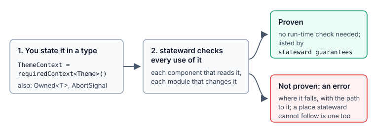

# stateward

**stateward helps keep invalid states unrepresentable in TypeScript and React code, and keeps
its code paths and logic predictable and transparent.** It runs in VS Code while typing, in the
terminal and in CI.

## Contents

- [Why stateward](#why-stateward)
- [What it looks like](#what-it-looks-like)
- [Try it](#try-it)
- [Using it](#using-it)
- [A minimal config](#a-minimal-config)
- [Packs](#packs)
- [Rules](#rules)
- [How well it works](#how-well-it-works)
- [How it relates to ESLint](#how-it-relates-to-eslint)
- [For contributors](#for-contributors)
- [Licence](#licence)

## Why stateward

**Predictable.** With a union instead of separate flags, a value is in one state at a time, and each
case is handled in one place, so a function can be read top to bottom to know what it does. A status added next
month fails to compile where it is not handled, instead of being handled by a `default`; an answer for the
previous page cannot overwrite the current one.

**Transparent.** Each finding names the problem, why it matters and the change to make, in the
code's own names. Where stateward could not check something, it says so ("not checked") and what would
let it. In VS Code, an error against a guarantee shows the steps that lead to it.

**Intentional.** Intent is written in plain TypeScript, such as a union,
`satisfies never` or a loader that takes an `AbortSignal`. For a promise such as "this context always
has a Provider" or "only this module changes the cart", a small type in the project
(`RequiredContext`, `Owned`) states it, and stateward proves every use; what it cannot prove is an
error. The developer decides what to state and what to change.

## What it looks like

**A screen rendered without the context it reads.** The context is stated required, so every
reader must be proven under its Provider:

```tsx
// theme.ts
export const ThemeContext = requiredContext<Theme>();

// App.tsx (Footer reads ThemeContext)
export function Settings() {
  return <Footer />;
}

// main.tsx
root.render(location.pathname === "/settings" ? <Settings /> : <App />);
```

```text
error[react-context/provider-missing]: `<Settings>` is rendered without `ThemeContext.Provider`
 --> src/main.tsx:5:49
  = fix: wrap it in `<ThemeContext.Provider value={…}>`, or render it inside a component that provides it
  = note: src/App.tsx:25: `<Footer>` is rendered
  = note: src/App.tsx:11: `Footer` reads `ThemeContext`
```

**An old answer that overwrites a newer one.** `fetchUser` takes an `AbortSignal`, so the effect
must abort it when `userId` changes:

```tsx
// api.ts
export function fetchUser(id: string, signal?: AbortSignal): Promise<User> { … }

// Profile.tsx
useEffect(() => {
  fetchUser(userId).then((user) => setName(user.name));
}, [userId]);
```

```text
error[react/effect-response-race]: `fetchUser(…)` takes an AbortSignal the effect never passes: an answer for an old `userId` can overwrite a newer one
 --> src/Profile.tsx:7:5
  = fix: create a controller in the effect, pass its signal to `fetchUser(…)`, and abort it in the cleanup:
        const controller = new AbortController();
        fetchUser(…, controller.signal)
        return () => controller.abort();
```

**Shared state changed from another file.** `cart` is stated `Owned`, so only `cart.ts` changes it:

```ts
// cart.ts
export const cart: Owned<{ items: string[] }> = { items: [] };

// checkout.ts
cart.items = [];
```

```text
error[ownership/state-written-outside-owner]: `cart` is changed outside its owner, `src/cart.ts`
 --> src/checkout.ts:4:3
  = fix: call one of `src/cart.ts`'s functions instead: `addToCart`, `clearCart`
```



There are rules for unions, lookup tables, async failures, errors and reducers too:
[the rules](#rules). How to bring this into an app you already have:
[best practices](docs/user/best-practices.md).

## Try it

In your app's folder (Node 20 or newer; npm, yarn, pnpm or bun):

```bash
npm install --save-dev stateward
```

```bash
npx stateward init
```

```bash
npx stateward check
```

Then install the VS Code extension (search "Stateward"). The
[quick start](docs/user/quick-start.md) takes about five minutes; [Using it](#using-it) walks
through every step.

## Using it

Each step from install to CI, with the page that covers it. Every command takes `--help`.

1. **Install.** `npm install --save-dev stateward` (or yarn, pnpm, bun):
   [install.md](docs/user/install.md).
2. **Set up.** `npx stateward init` asks which packs to use, writes `stateward.config.ts`, and
   prints the install line for the packs. `--yes` takes the suggested answers;
   `--packs unions,records` and `--preset strict` choose for you.
   [quick-start.md](docs/user/quick-start.md).
3. **Check.** `npx stateward check` lists the problems. In a big app, `npx stateward plan` shows
   how many places each rule flags, and with `rollout: true` in the config, `npx stateward next`
   turns the rules on one at a time. `check --rule <rule>` or `--group <group>` looks at one.
   [work-through-findings.md](docs/user/work-through-findings.md).
4. **Read a finding.** The first line is the severity, the rule and what is wrong; then the file,
   line and column; then `= fix:` with the change to make in your names, and `= docs:` with the
   command that explains the rule (`npx stateward explain <rule>`, the same text as the rule's page
   below). Places stateward could not decide are counted as "not checked";
   `check --verbose` or `npx stateward coverage` lists them.
   [quick-start.md](docs/user/quick-start.md#read-a-finding).
5. **Fix.** In VS Code, the lightbulb offers the fixes; each is tried on a copy of your code first.
   `npx stateward check --fix` applies the ones that cannot change how the code runs;
   `--fix --dry-run` shows them as a diff first.
   [work-through-findings.md](docs/user/work-through-findings.md#fix-in-bulk).
6. **VS Code.** Search for "Stateward" in the Extensions view. Findings show as you type, with
   quick fixes and hints about the errors a function can throw.
   [The extension's page](packages/vscode/README.md).
7. **CI.** `npx stateward init --ci github` writes `.github/workflows/stateward.yml`; add
   `--changed` to report only the files a pull request changes. `check --format github` annotates
   the pull request. [ci.md](docs/user/ci.md). Before each commit: `init --hook`,
   [pre-commit.md](docs/user/pre-commit.md).
8. **Existing code.** `npx stateward baseline` accepts today's problems, so only new ones fail
   `check`; `baseline --prune` drops the ones you fixed. `next --baseline` turns on the next rule
   and accepts its problems in one step.
   [work-through-findings.md](docs/user/work-through-findings.md#accept-what-is-there-today).
9. **Ignore one case**, as a last resort, when the code is meant to be that way: a comment above
   the line with the rule and why,
   `// stateward-ignore records/lookup-misses-key: keys come from the server's fixed list`.
   [work-through-findings.md](docs/user/work-through-findings.md#ignore-one-case).
10. **State what the code promises**, so stateward proves it instead of guessing: a context typed
    `RequiredContext<T>` must have its Provider above every reader, a value typed `Owned<T>` is
    changed only by its module. `npx stateward guarantees` lists each one and its proof.
    [guarantees.md](docs/user/guarantees.md).

What works well on a real app (rollout, which guarantees to state, ignores, CI, "not checked"):
[best-practices.md](docs/user/best-practices.md).

Also: [write a rule of your own](docs/user/write-your-own-rule.md) for a convention your team
keeps, and [what changed](CHANGELOG.md).

## A minimal config

```ts
// stateward.config.ts
import { defineConfig, defaults } from "stateward";
import { unions } from "@stateward/plugin-unions";
import { records } from "@stateward/plugin-records";

export default defineConfig({
  plugins: [unions(), records()],
  preset: "recommended", // or "strict"; without a preset no rule is on
  rules: { "records/lookup-misses-key": "warning" }, // one rule's severity, or [severity, options]
  groups: { "unions/cases": "error" }, // every rule of a group
  addons: [], // names of the add-on rules a pack keeps off until you ask
  exclude: [...defaults.exclude, "src/generated/**"], // keep the default skips (tests, stories)
});
```

Every key, settings per folder, and monorepos: [config.md](docs/user/config.md).

## Packs

Rules come in packs, each its own package. Turn on the ones that fit your app.

<!-- generated:packs -->

| Pack | What it promises | Package | Rules |
| --- | --- | --- | --- |
| [unions](docs/packs/unions.md) | Every case of a union is handled, and its tag tells the cases apart. | `@stateward/plugin-unions` | 3 |
| [records](docs/packs/records.md) | Lookup tables and records keyed by a union have every key, once, under a type that names them. | `@stateward/plugin-records` | 3 |
| [async](docs/packs/async.md) | An async failure is never lost: handlers catch their own, and state set before an await is set again when it fails. | `@stateward/plugin-async` | 2 |
| [react-context](docs/packs/react-context.md) | A component that needs a context is always rendered under its Provider. | `@stateward/plugin-react-context` | 2 |
| [errors](docs/packs/errors.md) | Errors are handled where they can happen: none ignored, none replaced in `finally`, no `Result` dropped. | `@stateward/plugin-errors` | 9 |
| [ownership](docs/packs/ownership.md) | One owner per piece of shared state and per brand: others call the owner's functions. | `@stateward/plugin-ownership` | 2 |
| [reducers](docs/packs/reducers.md) | A reducer reaches every state it declares and can leave every state it enters. | `@stateward/plugin-reducers` | 3 |
| [react](docs/packs/react.md) | Values that effects and memoized components depend on keep their identity; effects do not copy state, loop, leak or race; state updates see the latest state; flags do not stand in for one state. | `@stateward/plugin-react` | 10 |

<!-- /generated:packs -->

## Rules

Each rule links to its page: why it matters, what it catches and what it does not, how to fix what
it finds, and its options. The same tables, as one page: [docs/rules/README.md](docs/rules/README.md).

<!-- generated:rules -->

**Core** rules are on in every preset. **Coverage** rules point at code whose types do not say
enough for stateward to check it; they are info under `recommended` and errors under `strict`.
**Add-on** rules stay off until you list their add-on in `addons`; the table shows their severity
once it is listed. A rule marked (guess) judges from patterns in the code, not only from types, so
it can be wrong and is never an error unless you make it one.

### [unions](docs/packs/unions.md)

Every case of a union is handled, and its tag tells the cases apart. Package: `@stateward/plugin-unions`.

| Rule | What it finds | Why it matters | Kind | `recommended` | `strict` |
| --- | --- | --- | --- | --- | --- |
| [default-hides-cases](docs/rules/unions/default-hides-cases.md) | a `default` that handles cases the switch does not list, or that has no `never` check | A case added to the union later goes to the `default` with no compile error; listing the cases makes each switch fail to compile until it handles the new case. | Core | error | error |
| [if-chain-misses-case](docs/rules/unions/if-chain-misses-case.md) | an `if` / `else if` chain over a union that misses a case or has no `never` check | A case added to the union later goes to the last `else` with no compile error; testing every case and checking the rest with `never` makes the chain fail to compile. | Core | error | error |
| [tag-does-not-discriminate](docs/rules/unions/tag-does-not-discriminate.md) | a tag like `kind` that is `string` in one member, so a test on it does not pick a member | When `kind` is `string` in one member, testing `kind` does not narrow the union, so TypeScript cannot check which properties each branch reads. | Coverage | info | error |

### [records](docs/packs/records.md)

Lookup tables and records keyed by a union have every key, once, under a type that names them. Package: `@stateward/plugin-records`.

| Rule | What it finds | Why it matters | Kind | `recommended` | `strict` |
| --- | --- | --- | --- | --- | --- |
| [duplicate-key](docs/rules/records/duplicate-key.md) | the same key twice in a `new Map([...])` or `new Set([...])` written out in code | The same key twice in a `new Map([...])` or `new Set([...])` keeps only the last entry, so the first one has no effect. | Core | error | error |
| [lookup-misses-key](docs/rules/records/lookup-misses-key.md) | a lookup like `labels[status]` with no entry for some value of the key | A lookup like `labels[status]` is typed as always present; a value with no entry gives `undefined`, and the page shows "undefined" or the next call throws. | Core | error | error |
| [table-type-too-loose](docs/rules/records/table-type-too-loose.md) | a lookup table typed `Record<string, V>` that says neither "all keys" nor "keys from outside" | A table typed `Record<string, V>` lets a misspelt or missing key compile; typing its keys, or its reads as possibly missing, lets TypeScript check each read. | Core | error | error |

### [async](docs/packs/async.md)

An async failure is never lost: handlers catch their own, and state set before an await is set again when it fails. Package: `@stateward/plugin-async`.

| Rule | What it finds | Why it matters | Kind | `recommended` | `strict` |
| --- | --- | --- | --- | --- | --- |
| [handler-rejection-lost](docs/rules/async/handler-rejection-lost.md) | an async `onClick`, listener or timer callback whose failure is never caught | No code awaits an event handler or a timer callback, so its failure is an unhandled rejection the user never sees; a `catch` inside it can show the error. | Core | error | error |
| [pending-state-stuck-on-failure](docs/rules/async/pending-state-stuck-on-failure.md) | a "loading" state set before an `await` that stays set when the call fails (guess) | When the awaited call fails, a state set to "loading" before it stays set and the spinner shows until reload; resetting it in `finally` prevents that. | Core | warning | warning |

### [react-context](docs/packs/react-context.md)

A component that needs a context is always rendered under its Provider. Package: `@stateward/plugin-react-context`.

| Rule | What it finds | Why it matters | Kind | `recommended` | `strict` |
| --- | --- | --- | --- | --- | --- |
| [fake-default-value](docs/rules/react-context/fake-default-value.md) | a context created with a fake default like `{} as Theme` or `null!` | A default like `{} as Theme` is used when the Provider is missing, so the code reads an empty object typed as a full one and fails later. | Coverage | info | error |
| [provider-missing](docs/rules/react-context/provider-missing.md) | a component that reads a required context, rendered with no Provider above it | A component that reads a required context outside its Provider gets the default value or an error at run time; the finding shows the render path without it. | Core | error | error |

### [errors](docs/packs/errors.md)

Errors are handled where they can happen: none ignored, none replaced in `finally`, no `Result` dropped. Package: `@stateward/plugin-errors`.

| Rule | What it finds | Why it matters | Kind | `recommended` | `strict` |
| --- | --- | --- | --- | --- | --- |
| [must-handle-error](docs/rules/errors/must-handle-error.md) | a call that can throw an error marked `@mustHandle`, with no code that handles or passes it on | An error marked `@mustHandle` needs a decision at each call, such as a message to the user; a call that neither catches it nor passes it on lets it reach the top. | Core | error | error |
| [result-ignored](docs/rules/errors/result-ignored.md) | a `Result` dropped as a statement, after `void` or after `await` | A `Result` dropped as a statement discards its error, so a failed call looks the same as a successful one. | Core | error | error |
| [result-unchecked](docs/rules/errors/result-unchecked.md) | a call that fails in its value (an RTK Query trigger, a Result) used as if it had worked (guess) | A call that returns its failure instead of throwing never reaches the `catch`; without a check, the code after it runs as if the call worked. | Core | warning | warning |
| [throws-doc-mismatch](docs/rules/errors/throws-doc-mismatch.md) | a `@throws` tag that lists an error the function cannot throw, or misses one it can | Callers decide what to catch from `@throws`: a class it omits reaches them unhandled, and a class listed in excess asks them to handle a case that cannot happen. | Core | error | error |
| [catch-hides-unexpected](docs/rules/errors/catch-hides-unexpected.md) | a `catch` that handles some error classes with `instanceof` and ignores the rest | A `catch` that tests some error classes and has no last branch ignores every other error, bugs included; rethrowing the rest keeps them visible. | Core | error | error |
| [catch-misses-error](docs/rules/errors/catch-misses-error.md) | a `catch` that branches on error classes but misses one its `try` can throw | An error class the `try` can throw and the `catch` does not test goes to the generic branch, or is ignored; a branch for it, or a rethrow, handles it explicitly. | Core | error | error |
| [finally-can-throw](docs/rules/errors/finally-can-throw.md) | a `finally` that calls something that can throw and replace the original error | An error thrown in `finally` replaces the error that was already thrown, so the report names the cleanup instead of the original cause. | Core | error | error |
| [narrow-try](docs/rules/errors/narrow-try.md) | calls to your own code inside a `try` after the call it is for, so their bugs look like its failure | A bug in code inside a `try` meant for another call is caught and reported as that call's failure; moving the code after the `try` keeps the two apart. | Add-on `narrow-try` | warning | warning |
| [render-throw-without-boundary](docs/rules/errors/render-throw-without-boundary.md) | a component that can throw a known error while rendering, with no error boundary above it | An error thrown while rendering, with no error boundary above the component, unmounts the whole React tree and leaves a blank page. | Core | warning | warning |

### [ownership](docs/packs/ownership.md)

One owner per piece of shared state and per brand: others call the owner's functions. Package: `@stateward/plugin-ownership`.

| Rule | What it finds | Why it matters | Kind | `recommended` | `strict` |
| --- | --- | --- | --- | --- | --- |
| [brand-built-outside-owner](docs/rules/ownership/brand-built-outside-owner.md) | a cast to a checked brand like `as Positive` outside the file that owns its check | A cast to a checked brand like `Positive` outside its check skips the validation the brand stands for, so the type promises more than the value holds. | Core | error | error |
| [state-written-outside-owner](docs/rules/ownership/state-written-outside-owner.md) | shared module state changed by a file other than the one that declares it | When several modules change the same module-level state, each change must be read to know its value; one owning module with functions keeps that in one place. | Core | error | error |

### [reducers](docs/packs/reducers.md)

A reducer reaches every state it declares and can leave every state it enters. Package: `@stateward/plugin-reducers`.

| Rule | What it finds | Why it matters | Kind | `recommended` | `strict` |
| --- | --- | --- | --- | --- | --- |
| [state-cannot-leave](docs/rules/reducers/state-cannot-leave.md) | a reducer state that nothing leaves and that is not marked final | A reducer state with no way out keeps the user there for good, such as a failed payment with no retry; marking it final records that this is intended. | Core | warning | warning |
| [state-unreachable](docs/rules/reducers/state-unreachable.md) | a state of a reducer's union that no event can lead to | A reducer state that no event leads to is code that can never run, often a step that was planned and not written. | Core | error | error |
| [reducer-not-readable](docs/rules/reducers/reducer-not-readable.md) | a reducer, or a `return` in one, whose states cannot be read, so the reducer checks skip it | The reducer checks skip a place whose states cannot be read; a type that names its states brings it back under those checks. | Coverage | info | error |

### [react](docs/packs/react.md)

Values that effects and memoized components depend on keep their identity; effects do not copy state, loop, leak or race; state updates see the latest state; flags do not stand in for one state. Package: `@stateward/plugin-react`.

| Rule | What it finds | Why it matters | Kind | `recommended` | `strict` |
| --- | --- | --- | --- | --- | --- |
| [effect-copies-derived-value](docs/rules/react/effect-copies-derived-value.md) | an effect that only copies a value computed from props or state into state | Copying a computed value into state in an effect adds a render that shows the old value first; computing it while rendering shows the new value at once. | Core | warning | warning |
| [effect-loops](docs/rules/react/effect-loops.md) | an effect that sets, every time it runs, a state it depends on: a render loop | An effect that sets one of its own dependencies to a new value each time it runs triggers itself again, so the component renders without end. | Core | error | error |
| [effect-missing-cleanup](docs/rules/react/effect-missing-cleanup.md) | an effect that starts a listener, timer, subscription or connection and never stops it | A listener, timer or subscription that an effect starts and never stops keeps running after unmount, and each run of the effect adds another one. | Core | warning | warning |
| [effect-response-race](docs/rules/react/effect-response-race.md) | an effect that calls a loader taking an `AbortSignal` and does not abort it in its cleanup | Without an abort in the cleanup, the response to an old request can arrive after a newer one and replace the newer data on screen. | Core | error | error |
| [timer-runs-after-unmount](docs/rules/react/timer-runs-after-unmount.md) | a timer kept in a ref, never cleared on unmount, that navigates or calls out later | A timer kept in a ref and not cleared on unmount still runs after the component is gone, and can navigate or call out from a page the user left. | Core | warning | warning |
| [dependency-changes-every-render](docs/rules/react/dependency-changes-every-render.md) | an effect or memo dependency that a hook in the project creates anew on every render | A dependency that a hook in the project creates on every render makes the effect or `useMemo` run on every render, and a `memo` child render every time. | Core | warning | warning |
| [index-key-on-reordered-list](docs/rules/react/index-key-on-reordered-list.md) | `key={index}` on a list that is filtered, sorted or added to at the front (guess) | With `key={index}` on a list that is filtered or reordered, React keeps each row's state by position, so the state moves to a different item. | Core | warning | warning |
| [provider-value-changes-every-render](docs/rules/react/provider-value-changes-every-render.md) | a context Provider given a new object or function on every render | A Provider value created on every render re-renders every component that reads the context, even when nothing in the value changed. | Core | warning | warning |
| [closure-reads-stale-state](docs/rules/react/closure-reads-stale-state.md) | a timer, listener or callback that sets state from a value captured in an old render | A timer or listener created in an earlier render reads the state of that render; setting state from it overwrites newer values, which an updater avoids. | Core | warning | warning |
| [state-copies-prop](docs/rules/react/state-copies-prop.md) | a state copied from a prop and kept in sync by an effect | A state that copies a prop, kept in sync by an effect, differs from the prop for one render after each change and can overwrite what the user typed. | Core | warning | warning |

<!-- /generated:rules -->

## How well it works

A rule is on by default only when its findings were right at least 86% of the time on real
open-source projects. On two apps new to stateward, 94% of the default rules' findings read by hand
were right, and 99% after the fixes that followed. A first check takes about as long as
`tsc --noEmit` (0.9 to 1.8 times on eight open-source projects). From 1.0 to 1.1, the problems reported on eleven projects went from
601 to 461, with nothing new outside the rules that changed:
[real-world-results.md](docs/user/real-world-results.md).

It works on macOS, Linux and Windows, with any TypeScript version in your app (it brings its own
for reading). A finding you think is wrong is a bug: please
[open an issue](https://github.com/khoing1111/ts-stateward/issues) with the finding as printed and
the smallest code that causes it.

## How it relates to ESLint

typescript-eslint checks one function at a time and has a few exhaustiveness rules
(`switch-exhaustiveness-check`). stateward follows types and values across files and the whole
project (which Provider is above a component, which errors a call can throw, which file writes a
shared value) and asks about intent where a lint rule would have to guess. Use both: stateward
leaves out what typescript-eslint already checks well.

## For contributors

See [CONTRIBUTING.md](CONTRIBUTING.md).

## Licence

MIT, see [LICENSE](LICENSE). The VS Code extension lists the licences of what it bundles in
`THIRD-PARTY-NOTICES.txt`.
