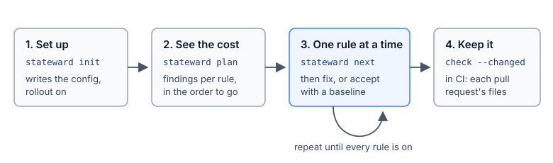
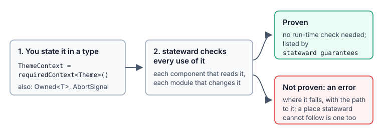
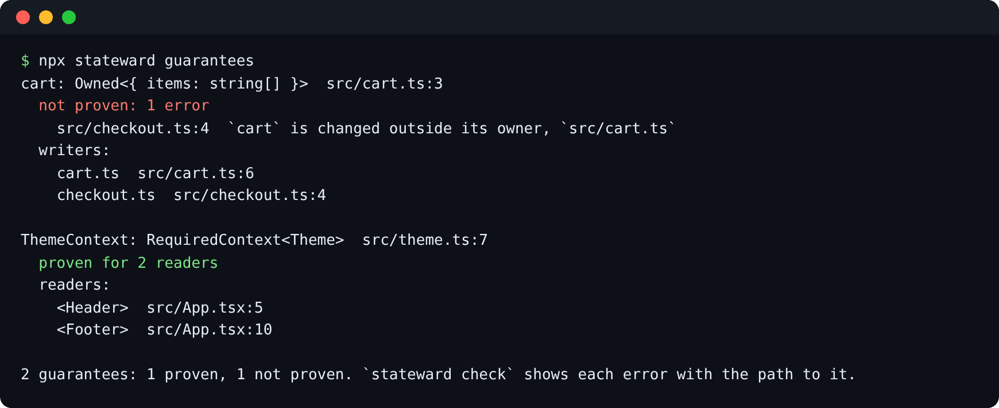

# Best practices

## Adopt it one rule at a time

A first check of an existing app with every rule on can report hundreds of findings. Turn the rules
on one at a time instead, and check new code from the first day.



1. **Install the app's packages first** (`npm install`). stateward reads imports through them, and
   without React's types the React rules cannot run (see
   [Not checked](#what-to-do-with-not-checked)).
2. **`npx stateward init`.** Answer "yes" to turning the rules on one at a time. It writes
   `rollout: true` in `stateward.config.ts`.
3. **`npx stateward plan`** shows each rule with its findings in your code, in the order to turn
   them on. Rules with nothing to fix come first.
4. **`npx stateward next`** turns on every rule that finds nothing, and the first one that does:

   ```text
   $ npx stateward next
   also on, nothing to fix: records/duplicate-key, records/lookup-misses-key, ...
   on: unions/non-exhaustive-switch (1 finding, 1 fixable)
   Every `switch` over a union handles every case: a `default` handles only the cases it allows, so a case added later is reported where it is not handled.
   run stateward check to see them
   ```

5. **Fix, or accept for now.** Fix what `check` shows, then run `next` again. When a rule has too
   many findings to fix now, `next --baseline` turns it on and accepts its findings, so only new ones
   fail:

   ```text
   $ npx stateward next --baseline
   on: records/table-type-too-loose (1 finding, 1 fixable)
   A table typed `Record<string, V>` lets a misspelt or missing key compile; typing its keys, or its reads as possibly missing, lets TypeScript check each read.
   run stateward check to see them
   baselined 1 finding of records/table-type-too-loose in 1 file; only new ones will fail from now on
   ```

6. **Commit `stateward.rollout.json` and `stateward.baseline.json`**, so the whole team and CI see
   the same rules.
7. **Check pull requests** with `--changed` ([below](#check-pull-requests-with---changed)).

After fixing accepted findings, run `npx stateward baseline --prune`. It drops them from the
baseline, so the baseline only shrinks. More in [work-through-findings.md](work-through-findings.md).

## State the intent in the type

stateward takes what a type states as true. The patterns below state intent in types, so a later
change that breaks it fails to compile where the change is made.

### Every case in a `switch`, and the cases a `default` allows

A `default` that returns "Unknown" also takes any status added later. When `"cancelled"` is added to
the union, the label shows "Unknown" and nothing fails to compile. List the cases. With
`unions/non-exhaustive-switch` on, a new case is then reported at every `switch` that does not
handle it. Without stateward, `status satisfies never;` in the `default` makes it a type error.

```ts
export type OrderStatus = "pending" | "paid" | "shipped" | "refunded";

export function statusLabel(status: OrderStatus): string {
  switch (status) {
    case "pending":
      return "Waiting for payment";
    case "paid":
      return "Paid";
    case "shipped":
      return "On its way";
    case "refunded":
      return "Refunded";
    default:
      return "Unknown";
  }
}
```

The `default` stays for values from outside (a server that sends a new status before the app knows
it); state such a union `OpenUnion<…>` and every `switch` on it must keep one
([guarantees.md](guarantees.md#openunion-a-union-that-can-gain-members)). When some cases share the
`default`, allow them there: `default: void (status satisfies "shipped" | "refunded");`.

### Tables typed `Record<Union, V>`

A table typed `Record<string, string>` accepts any key, so a missing status reads as `undefined` and
TypeScript reports nothing. Key it by the union, so that a missing entry fails to compile where the
table is written.

```ts
export const statusColor: Record<OrderStatus, string> = {
  pending: "grey",
  paid: "green",
  shipped: "blue",
  refunded: "orange",
};
```

`satisfies Record<OrderStatus, string>` does the same and keeps each value's own type. When the keys
come from outside (a server's map, user settings), type it `Partial<Record<string, string>>`
instead, and TypeScript requires every read to handle a missing entry.

### An `AbortSignal` in every loader

When an effect loads data and its input changes, the older request can answer last and overwrite the
newer answer, for example profile 1's name on profile 2's page. Give each loader a `signal`
parameter, and abort it in the effect's cleanup. stateward then checks every effect that calls them
(`react/effect-response-race`, on by default), and the quick fix writes the three lines.

```ts
export async function fetchUser(id: string, signal?: AbortSignal): Promise<User> {
  const response = await fetch(`/api/users/${id}`, { signal });
  return (await response.json()) as User;
}
```

```tsx
useEffect(() => {
  const controller = new AbortController();
  fetchUser(userId, controller.signal).then((user) => setName(user.name));
  return () => controller.abort();
}, [userId]);
```

A loader without a `signal` states nothing, so stateward does not check its callers (the add-on
`react/effect-race` reports the clearest cases). Adding the parameter is usually one line, and it
also cancels the network request.

### One state for an async result

`loading`, `error` and `data` side by side can contradict each other: loading and failed at once,
or the data of the previous request next to a new error. One union holds them without
contradictions, and every screen decides what each state shows:

```ts
type Save =
  | { status: "idle" }
  | { status: "saving" }
  | { status: "failed"; error: Error }
  | { status: "saved"; savedAt: Date };
```

A data library's own status (React Query, SWR, RTK Query) is the same thing. When a function that
`async/pending-state-stuck-on-failure` reports also writes other state, the finding's note names
them ("`saving`, `saveError` and `savedAt` are written together here"). No rule or quick fix
rewrites the state: which states exist is a design choice.

## State a guarantee where it holds

A guarantee states a property in a type, and stateward proves it everywhere the value is used. What
it cannot prove is an error, so state a guarantee only where the property holds.



- **`RequiredContext<T>` for a context every screen needs**: the theme, the signed-in user, the API
  client. Once every reader is proven, the hook's run-time check can be removed. Do not mark a
  context that has a real default that readers may use without a Provider.
- **A read-only view for module state with one owner**, before any marker: keep the mutable value
  private, and export a view typed `readonly` at every level with the functions that change it.
  TypeScript then rejects a change from any other file.
- **`Owned<T>` for module state with one owner** that is not restructured that way, or whose
  changes `readonly` does not see (a cast, a `Map`): a cache, a settings object, a list of jobs
  that one module keeps and others change only through its functions.

  ```ts
  export const cart: Owned<{ items: string[] }> = { items: [] };

  export function addToCart(item: string): void {
    cart.items.push(item);
  }
  ```

- **Not `Owned` on a store class that other modules call.** Each call from another module to a
  method that changes the object is an error:

  ```text
  error[ownership/state-written-outside-owner]: `cartStore` is changed outside its owner, `src/store.ts`
   --> src/a.ts:4:3
    |
  4 |   cartStore.add(item);
    |   ^^^^^^^^^^^^^
    = fix: add a function in `src/store.ts` that makes the change (e.g. `addCartStore(item)`), and call it instead
    = note: src/store.ts:6: `add` changes `this`
    = note: src/store.ts:13: `cartStore` is declared owned: only `src/store.ts` may change it
  ```

  For such a store, export functions from its module (`addToCart`), and mark the state they change;
  or leave the store unmarked, since the class's methods already control what changes it.

- **`Opaque<T, Name>` for a brand built by one check**: `OrderId`, `Positive`. Every value of it
  built outside its module, a cast or a plain value, is an error.
- **`Release<T>` on a function whose result must be released**: a subscription, a listener, a
  connection. A `Disposable` type states it with nothing to write, and the ownership pack knows
  Firebase, RxJS, Redux and zustand; a `facts` line states it for another package.
- **`Pending<T, Running>` for a state that marks work in progress**: it then settles on every way
  out of a function that sets it, and the function does not start while it runs.

`npx stateward guarantees` lists each one, whether it is proven, and the places it covers. It exits
with 1 when one is not proven, so it can run in CI next to `check`.



[guarantees.md](guarantees.md) is the catalog: for each trait, when to use it, when not, an
example and its finding.

## Ignore with a reason

When code is correct for a reason stateward cannot see, put a comment above the line with the rule
and the reason:

```ts
// Filled at start-up from the server, which sends a label for every status.
export const serverLabels: Record<string, string> = {};

export function labelFor(status: OrderStatus): string {
  // stateward-ignore records/lookup-misses-key: the server sends a label for every status
  return serverLabels[status];
}
```

The reason tells the next reader why the code is as it is. A comment without a reason is a warning,
and one that no longer covers a finding is reported, so stale comments are found. Use a baseline for
findings to fix later, and a comment for code that is intended.

## Check pull requests with `--changed`

On an app with a baseline, `--changed` makes a pull request fail only on what it adds. It still
checks the whole project, because a change in one file can break a reader in another, but reports
only findings in the files the branch changed, or that point into one:

```text
$ npx stateward check --changed main
...
1 error in 1 changed file (0.7 s) (3 baselined: `stateward baseline --prune` after fixing them). Run `stateward explain <rule>` for details.
```

`npx stateward init --ci github --changed` writes a GitHub workflow that does this on pull requests
and checks everything on the default branch ([ci.md](ci.md)).

## What to do with "not checked"

stateward reports code it could not check instead of counting it as clean. Each kind has its own
fix.

- **React's types are not installed.** The React rules read React's types and cannot run without
  them. `check` reports this above the summary, and `plan` marks each such rule:

  ```text
  not checked: 12 rules of the react-context and react packs: React's types are not installed (install the app's dependencies)
  ```

  Install the app's packages (`npm install`) and check again. In CI, install before `check`.

- **`strictNullChecks` is off.** TypeScript then does not check `null` and `undefined`, so a fix
  like `satisfies never` proves less. `check` names the tsconfig once:

  ```text
  `strictNullChecks` is off in `tsconfig.json`, so TypeScript does not check `null` and `undefined` and some fixes prove less: set `strict: true` or `strictNullChecks: true` in tsconfig.json
  ```

  With it on, `satisfies never` and `Partial<Record<…>>` also catch `null` and `undefined`.

- **Places a rule could not decide** (a type it cannot follow, a package it cannot read) are counted
  in one line. `npx stateward coverage` lists them per pack with the change that would let stateward
  check them, often a type annotation. Fix the places in important code; the rest can stay
  counted.
