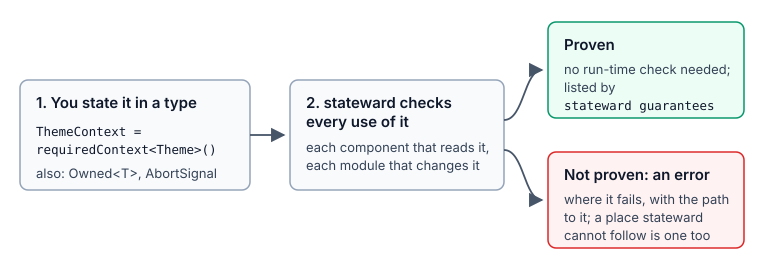

# Guarantees

A guarantee, or trait, is a property of the code that the code states, such as "this context
always has a Provider above it" or "what this function returns must be released". stateward then
proves it on every use. A use it cannot prove is an error with the path to it, or a place "not checked"
that says what it could not follow; a guarantee reads "proven" only when no finding stands against
it before ignore comments and settings are applied.
Without the statement, stateward infers the property from patterns in the code, which can be wrong
in both directions.



## How a trait is stated

The plainest statement wins, in this order:

1. **A standard type that already says it:** `Disposable` (the value must be released), an
   `AbortSignal` parameter (the request can be cancelled). Nothing to write.
2. **A marker type in the project's `src/guarantees.ts`:** a type with an optional
   `"__guarantee:<name>"` property. It needs no package, and the property exists only in the type,
   so nothing changes at run time.
3. **A `facts` line in the config,** for code the project cannot edit (a package).

```ts
// src/guarantees.ts
export type Owned<T = unknown> = T & { readonly "__guarantee:owned"?: true };
export type Release<T = unknown> = T & { readonly "__guarantee:release"?: true };
```

- **It is kept through refactors.** stateward reads the type, not its name: a local alias, a
  generic, a re-export, or a type from another package of the monorepo keeps it.
- **Traits combine.** Each marker has its own property, so a type states several by intersection:
  `RequiredContext<Store> & SingleProvider`. A marker's first parameter defaults to `unknown`, so
  the bare name is the trait alone; `Settings & Owned & Opaque<…>` reads the same flat or nested.
- **In a monorepo or a layered app,** a package that cannot import the app's `src/guarantees.ts`
  declares its own copy of the marker, or writes the property inline
  (`Settings & { readonly "__guarantee:owned"?: true }`): stateward reads the property, not where
  the type is declared.
- **A quick fix states it** on the finding that suggests it, offered only when the result
  compiles. `check --fix` never applies it: stating a trait is the developer's decision.
- **stateward 1.1's form** (`{ readonly __guarantee?: "owned" }`) is still read. Two traits in that
  form cannot combine (their intersection is `never`), so the lightbulb on such a marker offers
  "Rewrite the guarantee markers to the 1.2 form" for the whole file.

## The catalog

| Trait | States | Stated with | Proven by |
| --- | --- | --- | --- |
| [required context](#requiredcontext-every-reader-is-under-the-provider) | every reader is under the Provider | `RequiredContext<T>` | `react-context/provider-missing` |
| [owned](#owned-only-its-module-changes-it) | only its module changes the value | a read-only view, or `Owned<T>` | `ownership/state-written-outside-owner` |
| [opaque](#opaque-values-are-built-only-in-its-module) | values are built only in its module | `Opaque<T, Name>` | `ownership/brand-built-outside-owner` |
| [release](#release-the-value-must-be-released) | the value must be released | `Disposable`, `Release<T>` or a `facts` line | `ownership/resource-not-released` |
| [pending](#pending-work-in-progress-settles) | work in progress always settles, and does not start twice | `Pending<T, Running>` | `async/pending-state-stuck-on-failure` |
| [single provider](#singleprovider-the-provider-appears-once) | the context's Provider appears once on any render path | `SingleProvider` on the context's type | `react-context/provider-nested` |
| [stable](#stable-the-context-value-never-changes) | the context value never changes | `Stable` on the context's type | `react-context/provider-value-changes-every-render` |
| [open union](#openunion-a-union-that-can-gain-members) | the union can gain members at run time | `OpenUnion<T>` | `unions/non-exhaustive-switch` |
| [latest wins](#requests-where-the-latest-answer-wins) | an old answer never replaces a newer one | an `AbortSignal` parameter | `react/effect-response-race` |
| [never rejects](#jsdoc-tags-neverrejects-throws-initial-final) | the function's promise never rejects | `@neverRejects` | `async/handler-rejection-lost` |
| [throws](#jsdoc-tags-neverrejects-throws-initial-final) | the function throws only the classes listed | `@throws {AErr}` | `errors/throws-doc-mismatch` |
| [initial](#jsdoc-tags-neverrejects-throws-initial-final) | the reducer starts only in the states listed | `@initial "idle"` | `reducers/reducer-not-readable` |
| [final](#jsdoc-tags-neverrejects-throws-initial-final) | no reducer leaves the states listed | `@final "paid"` | `reducers/state-cannot-leave` |

## `RequiredContext`: every reader is under the Provider

**Use it** for a context with no meaningful default, whose hook throws when its Provider is
missing. **Not** for a context with a real default value.

```tsx
export const ThemeContext = requiredContext<Theme>();
```

The quick fix **State ThemeContext required: `requiredContext<Theme>()`**, on the declaration or
on a missing-Provider finding, writes the marker and its helper into `src/guarantees.ts` and
rewrites the declaration. Every component that reads the context (`useContext`, `use`,
`<ThemeContext.Consumer>`) must then be rendered under its Provider. A place stateward cannot
follow (a component picked at run time, a class component, JSX passed to a function, an app with
no entry point it can find, a component given to a slot its component hands on instead of
rendering, as `<Wrap><Reader/></Wrap>` with `wrap(children)`: "`Reader` is rendered through
`wrap(…)`, which cannot be followed") is an error that says what makes it provable:

```text
error[react-context/provider-missing]: `ThemeContext` (stated required) is not proven: the component behind `<Picked>` cannot be followed
  --> src/settings.tsx:15:10
   |
15 |   return <Picked />;
   |          ^^^^^^^^^^
   = fix: one of
       - render the component directly; constant maps are checked by the dynamic-components add-on
       - or pass the value to the component as a prop instead of through the context
   = note: src/settings.tsx:18: `<App>` is rendered
   = note: src/settings.tsx:21: `<Settings>` is rendered
   = note: src/settings.tsx:5: `ThemeContext` is stated required: every reader must be proven under its Provider
   = docs: stateward explain react-context/provider-missing
```

Every reference to the context is read, or listed as "not checked" at its place: a reader
(`useContext(ThemeContext)`, `use(ThemeContext)`, `<ThemeContext.Consumer>`, a hook of the project
given the context) in a component or hook the proof follows, and a Provider. Another name for the
context (`const C = ThemeContext`), the context passed to any other call (`makeHook(ThemeContext)`)
or kept in a literal (`{ theme: ThemeContext }`), and a class's `static contextType = ThemeContext`
are "not checked: `C = ThemeContext` gives the context another name, which stateward does not
follow: use the context by its own name", and the guarantee reads "not checked", never "proven" or "unused". A `const` name for its
Provider (`const P = ThemeContext.Provider`) is read as the Provider; a `let` one that the file
assigns again (`P = OtherContext.Provider`) is a tag the proof cannot follow, so the readers under
it are not proven (an error).

Once every reader is proven, the hook's run-time check is reported as an info with the fix **Remove
the run-time check in useTheme**. `react-context/fake-default-value` allows the one cast in
`requiredContext`. Tests are not part of the proof: wrap renders in the Provider in one helper.

## `SingleProvider`: the Provider appears once

**Use it** for a context that holds one instance (a store, a cache, a session): a second Provider
below the first would give part of the tree another instance. **Not** for a context that is
overridden on purpose (a theme for one panel).

```ts
export const StoreContext: RequiredContext<Store> & SingleProvider = requiredContext<Store>();
```

The marker goes on the context's type, not on the value: `Context<Store | undefined> &
SingleProvider` or `RequiredContext<Store> & SingleProvider`. `react-context/provider-nested`
then reports a Provider of it rendered under another one, with the outer Provider as a note.

The proof reads every place a Provider can be rendered, from the entry points (`createRoot`, the
`entries` option): the Provider's own JSX, `children` and the props that hold JSX, through the
components that render them in JSX, `memo` and `forwardRef` wrappers, and the add-ons' dynamic
components and routes. Those are the forms it reads; everything else is "not checked". It does not
follow a slot its component hands to a call or stores (`wrap(children)`, `{ child: children }`), a
Provider given to such a slot, or an element passed to a function or returned by one that is not a
component (`toast(<Inner/>)`, `const wrapInner = (c) => <Inner>{c}</Inner>`), or a Provider
written in a callback of its component (`useMemo(() => <StoreContext.Provider>…)`) or kept in a
variable (`const inner = <StoreContext.Provider>…</StoreContext.Provider>`). A second Provider
may be there, so each place is listed as "not checked: `wrap(children)` in `<Wrap>` cannot be
followed", and the guarantee reads "not checked" (exit 0) while one is left: the developer keeps the
say. A nested Provider the proof does see is an error. A slot that is only looked at
(`children ? … : …`, `children.length`) is not a place.

Every reference to the context is read, or listed as "not checked" at its place. A Provider the
walk lists (`<StoreContext.Provider>`, `<StoreContext value>`, a `const` name for
`StoreContext.Provider` used only as a tag) is read, and a reader is not about Providers. Another
name for the context (`const C = StoreContext; <C value={…}>`), the context or its Provider passed
to a call (`createElement(StoreContext.Provider, …)`) or kept in a literal is not checked.

## `Stable`: the context value never changes

**Use it** for a context whose value never changes, such as an "actions" context. **Not** for a
context that carries state.

The Provider's value must then be provably stable: `useMemo` or `useCallback` with stable
dependencies, a `dispatch`, a module constant, state whose setter is never used
(`const [store] = useState(createStore)`). Anything else is an error of
`react-context/provider-value-changes-every-render`, the strict form of what that rule reports
without the marker.

The proof lists every value the Provider's value is built from and reads each one. It reads the
names a `useMemo` or `useCallback` callback uses, written in place or named
(`useCallback(handler, [])`, `useMemo(build, [])`), through the local helper functions it calls
(`const helper = () => onSave(user)`), the object literals and nested closures inside them, and
the arguments of a call that makes a `const` it reads. Each read is:

- a value that never changes: a setter, `dispatch`, a ref (not a copy of what it holds: `const f =
  ref.current` can change), a module `const`, a module `let` that its file never assigns again, a
  hook result stateward knows to be stable: fine. A property of a module holder
  (`holder.current`) is read only when every write to it is in the proof's sight: a `readonly`
  property, a property of a namespace import, or a property of a `const` object written in place
  in this file, not exported, used only through its properties and never assigned there. A holder
  another file declares, a class instance (`store.actions`, which its own methods may write), or a
  holder used whole (`const h = holder`, `Object.assign(holder, …)`) is not checked;
- a value that can change (state, a prop, the result of a hook of the project, a module `let`
  that is assigned again, a property of a module `const` that its file assigns: `holder.current`
  with `holder.current = …`) that the dependency list names: the value changes, so it is not stable
  (the existing error);
- a value that can change that the list leaves out: "not proven: `helper` reads `onSave`, which
  the `useCallback` does not list".

The fix line offers a `useMemo` only when what the value reads never changes. Everything else is
**not checked**, and `stateward guarantees` says so instead of "proven" (it exits 0): the result
of a function stateward cannot read (`const actions = makeActions()`), a dependency list that is
not an array written in place, a callback that is neither written in place nor a function of the
component, a `value` given through a spread of props, and a Provider outside a component. A
function from another module reads nothing of the component.

Every reference to the context is read, or listed as "not checked" at its place: a Provider whose
`value` the proof reads (`<ActionsContext.Provider value={…}>`, and `<ActionsContext value={…}>`
for a context from React's `createContext`) is read, and a reader is not about the value. Another
name for the context or its Provider (`const C = ActionsContext`, `const Prov =
ActionsContext.Provider`), and either passed to a call (`createElement(ActionsContext.Provider,
…)`), are "not checked", since the value given there is not read.

## `Owned`: only its module changes it

**Use the plain TypeScript pattern first:** keep the mutable value private, and export a read-only
view (`readonly` at every level) with the functions that change it. TypeScript then rejects a
change from any other file, with no marker:

```ts
const state = { theme: "light", fontSize: 14 };

export const settings: { readonly theme: string; readonly fontSize: number } = state;

export function setTheme(theme: "light" | "dark"): void {
  state.theme = theme;
}
```

**Use `Owned`** for code that is not restructured that way, for changes `readonly` does not see (a
cast, a method of a `Map`), or to have each change proven. **Not** for a store class whose methods
other modules call: each such call changes the owned object from another module.

On a finding of `ownership/state-written-outside-owner`, the quick fix **Declare settings owned by
src/settings.ts** writes `Owned` into `src/guarantees.ts` and marks the declaration. Every change
from another module is then an error, through an alias, a destructured part, an element, a
function that returns it, a re-export or a cast; handing it to another module's function that
changes its argument is one too:

```text
error[ownership/state-written-outside-owner]: `session` is changed outside its owner, `src/session.ts`
 --> src/header.ts:5:3
  |
5 |   current.user = null;
  |   ^^^^^^^^^^^^
  = fix: one of
      - call `signOut` from `src/session.ts` instead: it owns the value
      - or, if these files share it on purpose, list them under the rule's `owners` option:
            { owners: { "src/session.ts": ["src/header.ts"] } }
  = note: src/header.ts:4: `current` is `session`
  = note: src/session.ts:3: `session` is declared owned: only `src/session.ts` may change it
  = docs: stateward explain ownership/state-written-outside-owner
```

The proof lists every use of the value outside its owner and reads each one. It reads:

- the name, an alias (`const s = settings`), an import or a re-export, and a plain function of the
  project that returns it (a method, a getter or a generator that returns it is not checked);
- a member, an element (`all[0]`), a destructured part, and a part reached through a cast;
- either side of `??`, `||` and `&&` (`const s = given ?? settings`): a change through it is a
  change of `settings`;
- a plain value read from it (a destructured `const { theme } = settings` shown in JSX:
  `<p>{theme}</p>`);
- an array or object literal that holds it (`[settings]`, `{ current: settings }`, `new Map([[k,
  settings]])`), and from it a `for … of` variable, an inline callback parameter (`forEach`, `map`,
  …), the array a callback is given as its last argument (`(item, i, all) => all.push(…)`) and an
  element read;
- a spread copy: `{ ...settings }` and `[...list]` are new at their first level only. A property
  of the copy can be assigned (`copy.user = null`), but nested values are shared, so
  `copy.tags.push("x")` and `copy.meta.n = 3` change the owned value and are errors.
  `structuredClone` copies every level;
- a function of the project given the value, read in its body, a destructured parameter
  (`function g({ meta })`) included: it changes the argument (an error), or only reads it. A body
  that reads `arguments` is not checked. A parameter typed `typeof settings` states nothing of its
  own: what its function changes is read at each call, so a helper nothing calls changes nothing;
- a prop of a component of the project whose type no code can change through (`Readonly<…>` or
  `readonly` at every level, no method, no mutable array or map), in a component that casts
  nothing and hands no object to `Object.assign` or to a writable parameter of the project
  (TypeScript lets a readonly value go to both: `bump(props.s.meta)`): a read. Otherwise the prop
  is not checked.

Each use is a read (fine), a change (an error: an assignment, `delete`, `++`, `Object.assign`, a
method that changes it, a change through a destructuring), or a place **not checked**. A method
of the value itself (`settings.reset()`) is a change when its body changes `this`, and not checked
when the method is declared by a type, whose body the proof does not reach. Everything
else is not checked, with what it is: the value assigned to a property or another variable,
pushed into a collection, given to a class (`new Keeper(settings)`) or a component, spread into
an argument list, or handed to a named function that `forEach` calls (`items.forEach(touch)`);
given to a parameter or value of function type (`f(settings)`), also by a function of the project
that hands it, or an element of it (`for (const x of xs) f(x)`), to its callback parameter
(`each(settings.items, (i) => …)`); to a package function (pass a copy,
or take a `Readonly` parameter), or to a function of the project that returns or stores its
argument; a value reached by a computed key (`table[key]`); a callee picked at run time, a value
cast to `any`, a parameter typed `Owned`. `stateward check` lists each place (`--verbose`), and
`stateward guarantees` reads "not checked", never "proven"; it exits 0 for it, as it does for a
guarantee that is unused. Files listed under the rule's `owners` option count as the owner.

The proof starts from every reference to the value (see
[Every reference is read](#every-reference-is-read-or-listed-as-not-checked)) and follows the value
from each one. A reference is read when every way the value goes from it ends in a read, a change
or one of the places above. Anything else is not checked at the reference, with what it is: a
class field or a default value that keeps it (`s = settings`), a getter or a function that returns
it (its callers are not followed), a generator that yields it, a call through `call`, `apply` or
`Reflect.apply`, a `Proxy` or another wrapper, a value given another name that other files can
import, and a change the rule cannot trace back to the value (`(flag ? settings : other).theme =
…`).

The hint names an owner's function only when it makes the same change: the same property, and the
same kind of value (`null` for `null`, an equal literal, a parameter of the right type, `++` for
`++`). Otherwise it says to add one.

## `Opaque`: values are built only in its module

**Use it** for a branded type whose values must pass a check (`OrderId`, `Positive`): only its
module builds one. **Not** for a label brand that any code may write.

```ts
// src/guarantees.ts
export type Opaque<T, Name extends string> = T & { readonly "__guarantee:opaque"?: Name };

// src/order-id.ts
export type OrderId = Opaque<string, "OrderId">;

export function orderId(raw: string): OrderId | undefined {
  return raw.startsWith("o-") ? raw : undefined;
}
```

The marker is optional, so TypeScript accepts a plain `string` where an `OrderId` is expected.
`ownership/brand-built-outside-owner` reports every value of the type built outside its module: a
cast, a plain value, an object literal, an `any`:

```text
error[ownership/brand-built-outside-owner]: `OrderId` is built from `"o-2"` outside `./order-id.ts`
 --> src/orders.ts:4:23
  |
4 |   const id: OrderId = "o-2";
  |                       ^^^^^
  = fix: one of
      - build it with `orderId()` from `./order-id`, and handle the `undefined` it returns
      - or, if this file checks the value itself, list it under the rule's `owners` option for `OrderId`:
            { owners: { "OrderId": ["src/orders.ts"] } }
  = note: src/order-id.ts:3: `OrderId` is stated `Opaque` here
  = docs: stateward explain ownership/brand-built-outside-owner
```

A brand written in the usual shape (`string & { readonly __brand: "OrderId" }`) keeps the rule's
1.1 behaviour, which reports casts only. Its finding offers the quick fix **State `OrderId` opaque**,
which rewrites the declaration to `Opaque<string, "OrderId">` and writes the marker. A value whose
type holds the brand is read by what is given to it: see below.

Every place a value of the brand is produced outside its module is listed and read. A place is
where a value goes into a place typed with the brand (or one that holds it): an initializer, a
default value, a returned value (an `async` function returning `Promise<OrderId>` too), an
argument, the right side of `=`, `??=`, `||=` or `&&=`, a property or element of a literal, a
`yield`, a JSX attribute; and a cast, a type predicate and an assertion function. `++`, `--` and a
compound assignment (`p -= 100`, `id += s`) on a place typed with the brand make a value no check
built: not checked. Each is:

- built by the brand's check (`orderId(raw)`, `raw.map(orderId)`, an alias of it): fine;
- built from a value the check did not make (`"bad"`, a template, an `any`, `(s) => s` given to
  `map<OrderId>`): an error, also when the place takes a union that holds the brand
  (`show("bad")` with a parameter `OrderId | number`). A type predicate that only takes
  `undefined` or `null` away from a value that already is the brand (`.filter((x): x is OrderId =>
  x !== undefined)` after `.map(orderId)`) builds nothing;
- a value of a container given where a container of the brand is expected (`string[]` returned as
  `OrderId[]`, a `Map<string, string>` as `Map<string, OrderId>`, `{ id: string }` as
  `{ id: OrderId }`): **not checked**, as which element the check built cannot be followed. Array
  and object literals are read element by element. `stateward guarantees` reads "not checked",
  never "proven", and exits 0 for it.

Every other way a value of the brand is made is listed too, by its type, and reads **not checked**
at its place (as far as the type checker can say): a generic call whose type arguments give the
brand (`getJson<Order>(url)` with `Order = { id: OrderId }`, `make<OrderId>("o-1")`); a class
member that overrides or implements one typed with the brand (`override id() { return "x"; }`
over `id(): OrderId`, `override idField = "x"`); an
overload's implementation that returns an `any`; a cast to a type parameter that extends the brand
(`"o-1" as T`); a call whose result is given as the brand while its arguments do not hold it
(`const byName: Record<string, OrderId> = Object.fromEntries(entries)`); a value declared with
`declare` (`declare const magic: OrderId`). A call of a package or standard-library function whose type argument a parameter
takes too (`useState<OrderId | null>(null)`, `new Map<OrderId, number>()`) makes no value of its own:
what it is given is read as an argument. Also not checked: `.call`, `.apply`, `.bind`, `Reflect.apply` and a spread argument
(`show(...ids)`); the target of a `for…of` (`for (order.id of raws)`); `Object.defineProperty`,
`Reflect.set`, `Object.assign` and a `Proxy` of an object that holds the brand; a function given
where one that returns the brand is expected (`const f: (s: string) => OrderId = (s: string): string => s`);
a JSX spread (`<Show {...props} />`). Inside the brand's module, and in a file the rule's `owners`
option lists, every one is fine.

## `Release`: the value must be released

**Use it** for a subscription, a listener, a connection: a value that keeps running until it is
released. **Not** for a value that ends by itself (a one-shot timer, a finished request).

The trait is stated in the plainest way that fits:

- **a standard type:** a value with `[Symbol.dispose]` or `[Symbol.asyncDispose]` (`Disposable`,
  `AsyncDisposable`). Node's own types are left out: they add these to child processes, streams
  and timers, which end by themselves;
- **the marker, on the project's own function:**

  ```ts
  export function watchPrices(onPrice: (price: number) => void): Release<() => void> {
    const id = setInterval(() => onPrice(read()), 1000);
    return () => clearInterval(id);
  }
  ```

- **a `facts` line for a package,** next to the `throws` facts: `"release"` calls the returned
  function, `{ release: "<method>" }` calls that method on it:

  ```ts
  facts: {
    "firebase/firestore": { onSnapshot: { returns: "release" } },
    rxjs: { "Observable.subscribe": { returns: { release: "unsubscribe" } } },
  }
  ```

The ownership pack ships facts for Firebase `onSnapshot`, RxJS `Observable.subscribe`, Redux
`Store.subscribe` and zustand `StoreApi.subscribe`; a config line for the same function wins.
For a value stated with the marker (a `Release` return type or parameter), every piece of code
between the start and the release is a way out, unless it is one of these, which cannot throw or
leave:

- names, literals, `this`;
- reads of a member declared as a property (of an interface, an object type, a class, a `Record`,
  an enum or a module); only a member declared as a getter or setter is a way out. This holds as
  far as the declared types say: a class that gives an interface's property as a getter is not
  seen. Also `length` of an array or string, `size` of a `Map` or `Set`, and a few more data
  properties of the platform's types;
- element reads: a literal index inside a tuple, a literal key of such a property, and a key of a
  `Record` or array whose value is a primitive and is not read further (`items[0].length` throws on
  an empty array, so it is a way out);
- destructuring of such properties (`const { n } = p`), and of an array;
- assignments to local names, and `++`, `--`, `+=`, `-=`, `*=` of plain values;
- `===`, `!==`, `&&`, `||`, `??`, `!`, `typeof`, `void`, `?:`, comparisons and `+`, `-`, `*` of
  plain values (a string, a number, a boolean), `/`, `%`, `**` of numbers (not `bigint`), and
  `instanceof` a class of the platform or of the project;
- objects and arrays of such values, a spread of an array of primitives (`[...xs]`), and a template
  whose parts are plain values;
- `if`, `switch`, blocks, `for`, `while`, `do`, `for…in`, and `for…of` over an array, a string, or
  `keys()`, `values()` or `entries()` of a `Map` or `Set` (not an `Iterable`, nor a union with one);
- the platform's calls that cannot throw, on the platform's own types: the value a method is
  called on is typed by the platform's type itself (an array, a `Map`, a string; not an interface
  or a class of the project, nor a type a class of the project extends, so a `Map` subclass's
  `get` is a way out), and the arguments' types make it safe: `console.log`, `Math.max` on
  numbers, `Number.isFinite`, `Number.parseInt`, `Object.keys`, `Object.values` and
  `Object.entries` on a type that is not `any` or `unknown`, `Array.isArray`, `Array.from` on an
  array or on `keys()`, `values()` or `entries()` of a `Map` or `Set`, `String(x)` and `Number(x)`
  on a primitive, `new Map()`, `new Set(xs)` and `xs.join()` on an array of primitives, `push`,
  `map`, `filter`, `reduce` with a start, `trim` (also on a branded string, `string & {…}`), the
  getters of a `Date` (`d.getTime()`), `n.toFixed(2)` with a number literal from 0 to 100, …; not
  `n.toString(base)`, `d.toISOString()`, `headers.set`, `Reflect.get`, `Promise.all` or
  `Promise.any`. Never a function of the project, and given only functions written in place whose
  code is on this list too;
- a `break` or `continue` that lands before the release.

Anything else is a way out: any other call or `new` (`JSON.parse(text)`, a function of the
project), `await`, `yield`, `return`, `throw`, a labelled `break` that skips the release, a
getter, a tagged template. Code that can throw inside a `try` with a `catch`, both after the start,
is caught when the release comes after the `try` (or in its `finally`): a release inside the same
`try` block is skipped by the throw, so `try { JSON.parse(text); stop(); } catch { … }` is an
error. A `return`, `yield` or `break` in the `try` is not caught. A release in a callback given to a call
(`done.then(() => stop())`) is not on this path, so it is not checked; a function called in place,
the executor of `new Promise`, `queueMicrotask` and `setTimeout` run it. A value returned by an
async function or a generator reaches its callers inside a promise or an iterator, which is not
followed: not checked. A value dropped by a comma (`(watchPrices(cb), 1)`) is never released.

For a value whose trait comes from `facts` or a `Disposable` type, an `await` between the start and
the release is a way out when it fails, except an `await` of a promise stated `neverRejects: true`
in `facts` (shipped for RTK Query's `cacheEntryRemoved`, so `await cacheEntryRemoved;
unsubscribe();` in `onCacheEntryAdded` is a release on every way out).
`ownership/resource-not-released` then requires a release on every way out of the function that
holds the value: calling it (or its method, or `using`), returning it, passing it to a parameter
typed `Release`, or storing it in a place the file releases (a place stated `Owned` is not read as
released: nothing says its module calls it). For a value stated with the marker, the file releases
a place only by a release that runs on every path of a function something can call (a method, an
exported function, a function the file calls or passes on): a module `let` released only under an
`if` is an error, and one released only in a function nothing calls is not checked. A value pushed
to a list (`this.stops.push(watchPrices(cb))`) is released by a loop that releases each item
(`for (const stop of this.stops) stop();`). A parameter typed `Release` is proven in its own
function, on every way out, and a caller counts as done only when that parameter is proven (it is
listed as a guarantee of its own). A release only in a function nothing calls is "not checked", never read as a release. A release under an `if`, in `finally` too (`finally { if (done) stop(); }`), or on one branch of a cleanup or a callback (`return () => { if (on) stop(); }`), is not on every way out; nor is a release only inside a loop (`for`, `for…of`, `while`) or a `forEach` or `map` callback, which runs zero times for an empty list; nor a variable given another value before its release (`stop = other; stop()`): each is an error. A value started in a React effect is proven the same way: the effect's returned cleanup is a release when it releases it, and a ref the file never releases (`ref.current = watchPrices(…)` with no `ref.current?.()`) is an error. A function of the project that returns the value with no type of its own (`function start() { return watchPrices(…); }`, an object's method, a static method) passes the trait to its callers, and a caller that drops the result is an error against the stated function. A value started on one branch (`const stop = on ? watchPrices(cb) : undefined`) must be released on every way out like any other.

Every reference to the stated function is read too (see
[Every reference is read](#every-reference-is-read-or-listed-as-not-checked)): a call the rule
traces, an import or a type. Any other reference is "not checked" at its place: the function given
as a value (`["a"].map(on)`) or copied to another name, and a call whose result the rule cannot
release (a promise of a `Release`, a value taken apart). Also not checked: a value kept in an
instance field (`private stop = watchPrices(…)`), returned from a callback (`[1, 2].map(() =>
watchPrices(…))`) or from a getter (`get sub() { return watchPrices(…); }`: reading `feed.sub` is
not followed), or given to a rest parameter. The note names where the trait comes from:

```text
error[ownership/resource-not-released]: `stop` from `watchPrices(…)` is never released
 --> src/start.ts:4:9
  |
4 |   const stop = watchPrices(() => undefined);
  |         ^^^^
  = fix: one of
      - call `stop()` when it is no longer needed
      - or return it, so the caller releases it
      - or, if it lives as long as the app, say so on the line above; the guarantee then reads not proven, ignored:
            // stateward-ignore ownership/resource-not-released: lives as long as the app
  = note: `watchPrices` returns a release function (its return type is stated `Release`)
  = note: src/prices.ts:5: `watchPrices` is stated `Release` here
  = docs: stateward explain ownership/resource-not-released
```

In a React effect, `react/effect-missing-cleanup` reads the same trait: such a value not released
in the cleanup is reported whatever the function is called.

**A value that lives as long as the app,** such as a store subscription started once at startup,
is never released on purpose. At the top of a module it is not reported. Started in a function
(`startConnectors()`), it is: say so on the line above, with the reason, so a reader sees the
choice:

```ts
export function startConnectors(): void {
  // stateward-ignore ownership/resource-not-released: lives as long as the app
  useToolStore.subscribe(ensureConnectors);
}
```

The comment hides the finding from `check`, but it does not prove the guarantee: `stateward
guarantees` reads "not proven: 1 ignored — lives as long as the app" and exits 1.

## `Pending`: work in progress settles

**Use it** for a state that marks work in progress (`saving`, `status: "saving"`). **Not** for a
data library's status (React Query, SWR), which settles by itself.

```ts
// src/guarantees.ts
export type Pending<T, Running extends T = Extract<T, true>> = T & {
  readonly "__guarantee:pending"?: Running;
};

const [saving, setSaving] = useState<Pending<boolean>>(false); // true means running
status: Pending<"idle" | "saving" | "saved" | "failed", "saving"> = "idle"; // "saving" means running
```

For `boolean`, `true` means running; for any other type, name the running values (a `Pending`
without them is reported). `async/pending-state-stuck-on-failure` then proves, for every function
that sets it running, that every way out leaves another value, and that a function that leaves it
running (it awaits or yields, or sets it back only in a callback, `async` or not) does not start
again while it runs. The fixes name the values from the type:

```text
error[async/pending-state-stuck-on-failure]: `status` stays `"saving"` when `post()` fails
 --> src/save.ts:9:5
  |
9 |     this.status = "saving";
  |     ^^^^^^^^^^^^^^^^^^^^^^
  = fix: one of
      - set `status` back in `finally`: `try { await post(); … } finally { this.status = "idle"; }`
      - or set it to "failed" in a `catch`: `try { await post(); … } catch (error) { this.status = "failed"; throw error; }`
  = note: src/save.ts:6: `status` is stated `Pending` here
  = docs: stateward explain async/pending-state-stuck-on-failure
```

Any work between the running write and the reset may fail: an `await` or a `for await`, a
`yield`, any call or `new` (synchronous code throws too: `this.data = JSON.parse(text)`), a getter
or setter that runs (`this.total`, `this.value = v`), an element read that is read further
(`this.items[0].name`), a tagged template (`` sql`…` ``) and a `for…of` over anything but an array
or a string; writing another state (`setError(null)`) is not work. The fix is the same for each:
set it back in a `finally`. A promise chain sets it back only if the failure path does too:
`.then(done, failed)` where `failed` does not set it back is an error, as `.then(done).catch(failed)`
is (a link counts only its own callbacks, so `.then(reset).catch(() => undefined)` resets on
success only), and a reset covers only the links before it: in `.catch(reset).then((r) =>
JSON.parse(r))` the last link can still fail, so the chain's last link must set it back.

It does not start twice when, on every path before the running write, it returns early on a test
of this state (`if (this.saving) return;`, `if (saving) return;`, `if (status === "saving")
return;`), or of a ref whose every write sits next to a write of the state with the same meaning
(`if (inFlight.current) return;` with `inFlight.current = true; setSaving(true);` and
`inFlight.current = false; setSaving(false);`); or when the element whose handler starts it is
disabled by such a test (`<button disabled={saving} onClick={save}>`). A test by the state's name in
any other form (an `if` nested in another, another object's field, `disabled` on another element)
is not checked, never an error.

These findings are errors, since the trait is stated; a state without the marker keeps the rule's
shape-based check, as warnings.

The proof lists every write of the state and every way out after a running write, and reads these
forms: the setter called as a statement of a function with a literal (`setSaving(true);`,
`this.status = "saving";`), a reset that runs on every way out (a `finally` or a `catch` that writes a
resting literal on every path; a statement after the work), and a resting literal in a `.then`,
`.catch` or `.finally` callback. A reset only on some paths is not proven: `finally { if (…)
setSaving(false); }` is an error ("`saving` is set back only on some paths of `save`"). Everything
else is "not checked", listed at the place, and the guarantee reads "not checked" (exit 0), never
"unused", while one is left:

- the setter copied (`const set = setBusy`), passed to a call or a component, stored or returned;
- an updater (`setLoading((v) => !v)`) or a value that is not a literal (`setSaving(next)`);
- a running write that is not a statement of its function (`setTimeout(() => setSaving(true))`);
- a reset that runs in a callback other than a promise chain's (`setTimeout(() => setSaving(false))`);
- a field or variable written by a compound or logical assignment (`this.busy ||= true`) or inside
  an expression.

Every reference to the state is read, or listed as "not checked" at its place: a field, a
`#private` field, a member of an object type (`const store: { saving: Pending<boolean> }`), a
module variable, and both names of a `useState` pair, or the setter alone (`const [,
setSaving] = useState<Pending<boolean>>(false)` is listed as `setSaving`). A pair kept whole
(`const saving = useState<Pending<boolean>>(false)`) is listed too, and its element reads
(`saving[1]`) are not checked: take it apart (`const [saving, setSaving] = …`). A read of the value is not a write, and a
`#private` field's guard (`if (this.#saving) return;`) counts as a public field's does. A write
through another name for the object (`const self = this; self.saving = true`) or by a computed key
(`store["saving"] = true`) is "not checked: `self.saving = true` writes it in a form the proof does
not follow".

An object that holds the state can also be written without naming it, and each such place reads
"not checked" (never "proven", never "unused"): `Object.assign(this, { saving: true })`,
`Object.defineProperty`, `Reflect.set` or a computed key on it; a new object for a state that holds
it (`useState<{ saving: Pending<boolean> }>`: `setForm({ ...form, saving: true })`), and a reducer's
state (`return { status: "saving" }`). Keep the running value in a state of its own
(`useState<Pending<boolean>>`) or a field to have it proven.

## `OpenUnion`: a union that can gain members

**Use it** for a union that comes from outside the code (a status from a server, an event type from
a package). **Not** for a union the code owns.

```ts
// src/guarantees.ts
export type OpenUnion<T = unknown> = T & { readonly "__guarantee:open-union"?: true };

// src/orders.ts
export type OrderStatus = OpenUnion<"pending" | "paid" | "shipped">;
```

`unions/non-exhaustive-switch` then requires every `switch` on an `OrderStatus` to have a
`default` that handles a value it does not list. The `default` is read by two fixed lists.

It throws, and is reported ("the `default` throws on a value outside `OrderStatus`"), when it ends
in one of these, with no value returned before it:

- a `throw`;
- a call that never returns: one typed `never` (`assertNever(status)`), or a function of the
  project that always throws whatever its type says (`fail(status)` typed `void` or `string`, an
  object's or a class's method, a function written and called in place), as a statement, kept in a
  variable (`const result = assertNever(status)`) or returned;
- an awaited `Promise.reject(…)`, or `Promise.reject(…)` or `new Promise((_, reject) =>
  reject(…))` returned from a function that returns a promise;
- an assertion function given `false` (`invariant(false, …)`);
- only a check against `never` (`const unreachable: never = status`), which TypeScript reads at
  compile time while at run time the value goes through unhandled;
- a `break`, or nothing, when the code after the `switch` ends in one of these.

It handles the value when it ends in a returned value, a statement or an `if`, or falls out of the
`switch` into code that does, and nothing in it can throw on the way. Any other ending (another
assertion, a rejection returned from a function that does not return a promise, a loop, a `try`)
reads "not checked", as does a value built from code that throws: a call that never returns inside
it (`return up(fail(status))`, `return [fail(status)]`, `return fail(status) ?? "?"`), a `new` of a
class whose constructor throws, a getter that runs, and a call of the platform that is not one of the
calls known not to throw (`JSON.parse("")`).

Every place the code decides by a value of the union is listed, and a `switch` on the value itself
is read, as is a lookup with a fallback (`labels[status] ?? status`), which gives a value the table
does not have the fallback (a fallback that throws, `labels[status] ?? fail(status)`, does not
handle it). Anything else reads "not checked" at its place, with or without a final
`else`: an `if` or an `if`/`else` chain, a `switch (true)` with comparisons ("not checked: the
`switch (true)` on `status` is not read as a switch"), a `?:` (by design: write a `switch`), a
comparison kept in a value, a lookup by the value with no fallback (`labels[status]`), an `in`
test, a call that decides by it (`list.includes(status)`, `map.get(status)`, `Object.is(status,
…)`, `pattern.test(status)` and any other call that answers yes or no, `Reflect.get(labels,
status)`, `Object.hasOwn(labels, status)`), a method called on it (`status.startsWith("p")`), and a
`switch` or a comparison on a value made from it (`status as string`, `String(status)`,
`` `${status}` ``, `status.toLowerCase()`), a `<`, `<=`, `>` or `>=` comparison, and the value
given to a parameter or variable typed by a closed union (`text(status)` with `text(k: "pending" |
"paid")`, `const k: "pending" | "paid" = status`), where the code decides as if no other value
could come. Write it as a `switch` with a `default` to have it
proven:

```text
error[unions/non-exhaustive-switch]: `switch` on `order.status` has no `default` for a value outside `OrderStatus`, which is open
 --> src/orders.ts:7:3
  |
7 |   switch (order.status) {
  |   ^^^^^^
  = fix: add `default:` that handles an unknown status
  = note: src/orders.ts:3: `OrderStatus` is stated open (`OpenUnion`)
  = docs: stateward explain unions/non-exhaustive-switch
```

No quick fix writes `OpenUnion`: add the line to `src/guarantees.ts`.

**`OpenUnion` or a parse at the boundary.** When the data is parsed where it enters, by a schema
that rejects an unknown status, the parsed value is closed: type it with the closed union, and
`OpenUnion` is not needed. Use `OpenUnion` when values reach the code without such a parse, or
when the parse lets unknown values through (a plain string cast to the union, a schema with a
fallback).

## JSDoc tags: `@neverRejects`, `@throws`, `@initial`, `@final`

Where no type can say it, a JSDoc tag states the intent, and `stateward guarantees` lists each
tagged declaration as a guarantee ("stated by the JSDoc tag `@neverRejects`"). The tag is proven,
never taken at its word: the rule reads the code the tag is on, and every reference to the tagged
declaration is read or listed as "not checked" at its place. A call, an alias, an argument or an
import only uses what the tag states; what each rule reads is below. TypeScript attaches a JSDoc
comment to the declaration that follows it; one written on the same line after a `{`
(`class K { /** @throws {E} */ run() … }`) is not attached, so it is not read.

- **`@neverRejects`** (on a function, a method, a variable that holds a function, a prop in a props
  type): the function's body, and every function given to a tagged prop or name (`onSearch={post}`,
  `{ onSearch: post }`). A `throw`, `JSON.parse(…)`, a call known to reject (`fetch`, a package
  that rejects, a function of the project that does, through `.call`, `.apply` or a `const` alias
  too) and a `new Promise` whose executor rejects or throws, outside a `try` with a `catch`, are
  errors. A call stateward cannot see into (a package with no facts, a dynamic `import()`, a
  promise held in a variable), a call or `new` of the platform or a package that can throw at once
  (`new URL(text)`, `list.reduce(add)` with no start, `decodeURIComponent(text)`, `new
  Array(size)`, also returned), a `for await`,
  a tagged function with no body, a value of a tagged function type, a function given through
  a spread of props, a read of a member declared as a getter (a member declared as a
  property is read as one, as far as the declared types say) and an element read that is read further (`xs[0].length`) are "not checked".
  `Promise.any` of no promise, or of promises that all reject, rejects. Calls known not to throw
  are read as safe on the platform's own types only, with arguments whose types make them safe
  (the closed list of `Release` above): `setTimeout`, `console`, `Math` on numbers, `String(x)` on
  a primitive, `new Map()`, `new Set(xs)` on an array of primitives, `new Error`, and array and
  string methods such as `map`, `push` or `trim`; a function of the project is read, and a call that starts a promise chain (`fetch(url).then(…)`)
  is read with the chain. A `try` catches what it awaits or calls inside it, not a promise it
  returns without `await`: `try { return post(); } catch { … }` rejects when `post()` does.
- **`@throws {AErr}`** (on a function, a method, a variable that holds a function): the body,
  through the functions it calls, `.call` and `.apply` of them, a `throw` of an error kept in a
  `const` or built with `Object.assign(new X(), …)`. A class it can throw that the tag does not list
  is an error; the platform's calls are read by what they throw (`JSON.parse` a `SyntaxError`,
  `n.toString(base)` and `n.toFixed(d)` a `RangeError`, `headers.set` a `TypeError`). A call it
  cannot follow, an error made by a call (`throw makeError()`), a getter or setter that runs (a
  member declared as a property is read as one, as far as the declared types say), a generator, a `@throws` without a
  class, and another function given to the tagged name are "not checked".
- **`@initial "red"`** (on a reducer): each `useReducer(reducer, start)` and
  `useReducer(reducer, arg, init)` whose start can be read (a literal, a `const`, what `init`
  returns), and a direct call of the reducer with a state it can read. A `const` start that is
  changed after it is made (`start.color = "yellow"`, `Object.assign(start, …)`) cannot be read. A
  start the tag does not list is an error. A reducer given to another function (`useMachine(light, …)`) or another name
  (`const r = light`), a start it cannot read, and a reducer whose state is not a union of objects
  told apart by one property (`"red" | "green"`) are "not checked".
- **`@final "paid"`** (on the state type): every reducer over the type. A return that leaves a final
  state from a branch that checks the state is an error. A return whose starting states cannot be
  read (the state's tag copied to a variable or destructured, `switch (true)`, a helper such as
  `isDone(state)`) or whose state cannot be read is "not checked".

## Requests where the latest answer wins

**Use it** for a loader an effect calls with inputs that change. The statement is plain
TypeScript: the loader takes an `AbortSignal` (`fetch`, axios's config, any `signal` parameter or
option).

```ts
export async function fetchUser(id: string, signal?: AbortSignal): Promise<User> {
  const response = await fetch(`/api/users/${id}`, { signal });
  return (await response.json()) as User;
}
```

`react/effect-response-race` then requires every effect that calls it and sets state from its
answer to abort it in the cleanup, or to check a flag the cleanup sets. The quick fix **Abort
fetchUser(…) when the effect is cleaned up** writes the controller, the signal and the abort:

```text
error[react/effect-response-race]: `fetchUser(…)` takes an AbortSignal the effect never passes: an answer for an old `userId` can overwrite a newer one
 --> src/profile.tsx:7:5
  |
7 |     fetchUser(userId).then(setUser);
  |     ^^^^^^^^^^^^^^^^^
  = fix: create a controller in the effect, pass its signal to `fetchUser(…)`, and abort it in the cleanup:
        const controller = new AbortController();
        fetchUser(userId, controller.signal)
        return () => controller.abort();
  = note: state is set from the answer
  = docs: stateward explain react/effect-response-race
```

The cleanup must abort on every path: `return () => { if (keep) controller.abort(); }` is an
error ("effect aborts `controller` only on some paths of its cleanup"). A flag guards a write only
when the effect writes it nowhere but its cleanup (`active = true` after the `await` sets it back
before its test), and when it is checked after the last `await` before the write: `if (!active) return; const user =
await fetchUser(id); setUser(user);` checks it before the answer arrives, so it is an error. `stateward guarantees` lists
each loader of the project that an effect calls ("`fetchUser`: stated by its type, `AbortSignal`"),
with every effect call it covers; each error of the rule about a call to it reads "not proven".
A loader of a package (`fetch` itself, axios) is checked the same way but not listed.

An effect that runs once needs none of this, and TanStack Query, SWR and RTK Query cancel their own
requests. A loader with no signal states nothing; the add-on `react/effect-race` reports the
clearest case as a warning.

## List them

`stateward guarantees` lists every trait the code states, where it is stated, whether it is
proven, and what it covers:

```text
$ npx stateward guarantees
ThemeContext: RequiredContext<Theme>  src/contexts.ts:6
  stated by the project's marker
  proven for 2 readers
  readers:
    <Header>  src/Readers.tsx:4
    <Footer>  src/Readers.tsx:8

watchFeed: Release  src/feed.ts:3
  stated by the project's marker
  proven for 1 caller
  callers:
    feed.ts  src/feed.ts:9

session: Owned<{ user: string | null }>  src/session.ts:3
  stated by the project's marker
  not proven: 1 error
    src/toolbar.ts:9  `session` is changed outside its owner, `src/session.ts`
  writers:
    session.ts  src/session.ts:6
    toolbar.ts  src/toolbar.ts:9

3 guarantees: 2 proven, 1 not proven. `stateward check` shows each error with the path to it.
```

A release trait from a type or from facts is listed at each call, with its source: "stated by its
type, `Disposable`", "stated by stateward's facts for rxjs", "stated by the config's facts for
my-client".

- **Proven**: its rule ran on every place it covers and found nothing against it, whatever the
  ignore comments and settings say.
- **Not proven**: the errors against it, each at the place it fails. A baselined error still counts,
  and so does a finding an ignore comment hides: the comment keeps it out of `check`, but the
  guarantee reads "not proven: 1 ignored — lives as long as the app", with each comment's reason.
- **Unused**: no code refers to it, so there is nothing to prove; use it or drop the marker. A
  finding that is silenced never makes a guarantee unused.
- **Not checked**: its rule is not on yet (with `rollout`), or is off for a place it covers (the
  rule off, or an `overrides` entry); `stateward next` turns it on. Also a place the rule cannot
  follow, such as a release only in a function nothing calls, or an `if` chain over an open union;
  the line says what it is.

A finding against a stated value always counts against it. A rule that makes a finding says which
declaration it is against, however the code reaches the value (through an alias, a destructured
import, a Provider in another file), and `stateward check --format json` lists those declarations in
the finding's `guarantees`. `stateward guarantees` then reads that guarantee as "not proven",
whatever the finding's severity, the cap on findings per file, or the `unknowns` setting says: a
finding that only says "not checked" leaves its guarantee "not checked" at that place. So the two
commands cannot disagree: an error `check` reports against a stated value is never "proven" or
"unused" in `stateward guarantees`, and `guarantees` exits 1.

A declaration that states a guarantee in its written type (a `#private` field, a member of an object
type, a parameter) which no rule proves is listed too, as "not checked: `Owned` is stated on a declaration no rule
checks: state it where its pack's page shows",
and "not proven" when `check` reports an error at it.

### Every reference is read, or listed as not checked

For `Owned`, `Release`, `RequiredContext`, `SingleProvider`, `Stable`, `Pending`, `Opaque`, `OpenUnion` and the JSDoc tags, stateward lists every reference to the stated declaration, the way the
editor's "find all references" does: by the type checker, through imports, re-exports, renamed
imports, destructured names and shorthand properties. Each reference must be read by the
guarantee's rule. One the rule does not read is listed at its place as "not checked", with the
code, what it does, and what to write instead:

```text
on: Release  src/a.ts:3
  stated by the project's marker
  not checked: `["a"].map(on)` (given as an argument) is a use of `on` that stateward does not read for `Release`: write it the way `stateward explain ownership/resource-not-released` shows
    src/a.ts:8  not checked: `["a"].map(on)` (given as an argument) is a use of `on` that stateward does not read for `Release`: write it the way `stateward explain ownership/resource-not-released` shows
```

So a way of using the value that no rule reads is "not checked", never "proven", and a
guarantee reads "unused" only when nothing refers to it, or only imports, exports and types do
("unused: referenced only by imports or types"). A function stated by its return type that
no rule lists (`async function on(): Promise<Release<…>>`) is listed as "not checked: `Release` is
stated on a declaration no rule checks", with each of its references. What the type checker cannot connect by name (a
value copied by a spread, assigned to a structural type) is not a reference: the rule follows the
value from each reference instead, as its section says.

For a type (`Opaque`, `OpenUnion`) and an object that holds a `Pending` state, a name is not
enough: stateward also lists every place a value of the type flows, by its type: where a value of
the brand is made (a cast, an `any`, a generic call, a spread, …), where the code decides by a value
of the union (a `switch`, a comparison, a lookup), where an object holding the state is written
without naming it. Each section above says which of them its rule reads; the rest read "not
checked". This scan asks the type checker about every value in the files that import the type's
module, directly or not, and only when a file states such a type. In a very large file it stops
after a fixed number of questions, and the guarantee then reads "not checked: the file is too large to
read past …" there, never "proven".

No setting turns a finding against a stated guarantee into a proof: a rule's severity (`info` or
`off`), a `severities` kind, an `ignore` option, an `overrides` entry. A kind set to `off` still
reports a finding against a stated guarantee, as an info.

`--format json` prints the same for scripts, each entry with its `source`. The exit code is 1 when
a guarantee is not proven (errors, or findings hidden by ignore comments), so it can run in CI next
to `check`; it is 0 when every guarantee is proven, unused or not checked (a place the rule cannot
follow, or a rule that is off). "Not checked" is shown and never counted as proven.

## In the editor

In VS Code, a stated declaration shows its proof, from the last check:

- **Hover** the name: "Guaranteed: every reader is rendered under its Provider; proven for 2
  readers", or the first error and the steps that lead to it. For a trait from a type or facts, the
  hover names the source.
- **A code lens** above it, "2 readers proven · show", lists the places it covers; errors first.
- **Show proof path**, in the lightbulb of an error against a guarantee, steps through the path.
