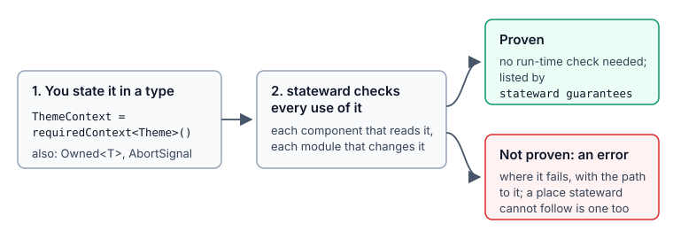
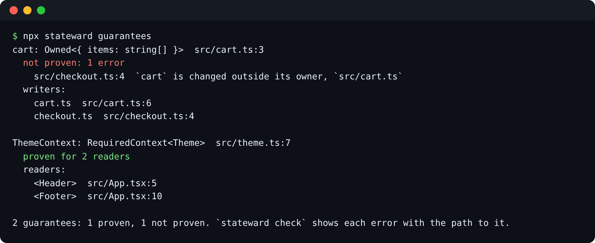

# Guarantees

A guarantee is a type that states a property of the code, such as "this context always has a
Provider above it". Without the type, the property is checked only at run time or not at all, and
stateward infers it from patterns in the code, which can be wrong in both directions. With the type,
stateward checks every use and reports each one it cannot prove as an error, with the path to it.



## What a guarantee is

A guarantee is a type your project owns, with an optional `__guarantee` property that names it:

```ts
export type RequiredContext<T> = Context<T> & { readonly __guarantee?: "required-context" };
```

- **It is in the project's code.** The type is in `src/guarantees.ts` and needs no package. The
  property exists only in the type, so nothing changes at run time.
- **It is kept through refactors.** stateward reads the type, not its name, so a local alias, a
  generic, a re-export, or a type from another package of the monorepo keeps the guarantee.
- **It is searchable.** Hover shows the property, and `grep __guarantee` lists every guarantee.

There are two guarantees: `required-context`, read by `react-context/provider-missing`, and
`owned`, read by `ownership/state-written-outside-owner`. Some properties need no extra type,
because TypeScript already expresses them. A loader that takes an `AbortSignal` can be cancelled
([Requests where the latest answer wins](#requests-where-the-latest-answer-wins)).

## `RequiredContext`, step by step

### 1. Start from a guarded context

The usual React pattern is a context with no default and a hook that throws when its Provider is
missing:

```tsx
export const ThemeContext = createContext<Theme | undefined>(undefined);

export function useTheme(): Theme {
  const theme = useContext(ThemeContext);
  if (theme === undefined) throw new Error("useTheme needs a ThemeContext Provider");
  return theme;
}
```

`react-context/provider-missing` already infers from the hook's check that this context is
required. The check runs only at run time, so a page rendered without the Provider fails when a
user opens it.

### 2. State it: the quick fix

In VS Code, put the cursor on the declaration and open the lightbulb: **Declare ThemeContext
required: `requiredContext<Theme>()`**. A missing-Provider finding on that context offers the same
fix and suggests it in its fix line:

```text
= fix: wrap it in `<ThemeContext.Provider value={…}>`, or render it inside a component that provides it
      // if it is always under its Provider, state it (quick fix); stateward proves every reader:
      const ThemeContext = requiredContext<Theme>();
```

The fix:

- writes `src/guarantees.ts` the first time (the nearest `src` folder above the file; the file's
  own folder if there is none), and imports from it after that;
- rewrites the declaration to `export const ThemeContext = requiredContext<Theme>();`.

It is tried on a copy of the code first and offered only when it compiles. `check --fix` never
applies it, because stating a guarantee is a decision for the developer. The file it writes:

```ts
// Stated guarantees: types that say what the code promises, so stateward proves it instead of
// guessing. Each marker has an optional `__guarantee` property that exists only in the type:
// nothing here adds code at run time. See https://github.com/khoing1111/ts-stateward/blob/main/docs/user/guarantees.md
import { createContext, type Context } from "react";

/**
 * A React context that every reader gets from a Provider: stateward proves each component that
 * reads it is rendered under its Provider, and reports any it cannot prove. Readers need no check
 * for a missing Provider.
 */
export type RequiredContext<T> = Context<T> & { readonly __guarantee?: "required-context" };

/** Creates a `RequiredContext`: it has no default, since no reader can run without a Provider. */
export function requiredContext<T>(): RequiredContext<T> {
  // The one cast: the default is never read, because every reader is under a Provider.
  return createContext<T>(undefined as never);
}
```

`react-context/fake-default-value` allows that one cast, in a function that returns a
`RequiredContext`. A `RequiredContext` made with a cast anywhere else is still reported.

### 3. stateward proves every reader

After that, for this context:

- every component that reads it, with `useContext`, `use` or `<ThemeContext.Consumer>`, checked or
  not, must be rendered under its Provider (`<ThemeContext value={…}>` counts too);
- a missing Provider is an error at the place it goes missing, with the path down to the reader
  and a note at the declaration that states the guarantee;
- a place stateward cannot follow is an error, not "not checked". Such places are a component
  picked at run time (`const Page = pages[name]`), a class component, JSX passed to a function, a
  reader that nothing renders, and an app with no entry point stateward can find. Each error says
  what makes the place provable: render the component directly or under the Provider, pass the value as a prop, the
  `react-context/dynamic-components` add-on for a `const` object of pages, or `entries` in the
  react-context options for an entry point.

```text
error[react-context/provider-missing]: `ThemeContext` (stated required) is not proven: the component behind `<Picked>` cannot be followed
  --> settings.tsx:20:10
   = fix: pass the value as a prop, or render the component directly; constant maps are checked by the dynamic-components add-on
   = note: settings.tsx:23: `<Page>` is rendered
   = note: settings.tsx:6: `ThemeContext` is stated required: every reader must be proven under its Provider
```

### 4. Drop the check

Once every reader is proven, the hook's check adds nothing to the types. stateward reports it as
an info, "`useTheme` checks `ThemeContext` at run time, but every reader is proven under its
Provider", with the fix **Drop the check in useTheme**. While any reader is not proven, the
check stays and nothing suggests dropping it.

```tsx
export function useTheme(): Theme {
  return useContext(ThemeContext);
}
```

## `Owned`: only its module changes it

### 1. Start from shared state

A module-level value that other files import, and the function meant to change it:

```ts
export const settings = { theme: "light", fontSize: 14 };

export function setTheme(theme: string): void {
  settings.theme = theme;
  localStorage.setItem("theme", theme);
}
```

`ownership/state-written-outside-owner` already infers that this is shared state and reports another
file that changes it (`settings.theme = "dark"` in `toolbar.ts`). The inference misses a change
through an alias, a function that returns the value, or a cast.

### 2. State it: the quick fix

On that finding, the lightbulb offers **Declare settings owned by src/settings.ts**. The fix:

- writes `Owned` into `src/guarantees.ts` (the same file as `RequiredContext`; created the first
  time, added to it when it lacks `Owned`, imported when it has it);
- marks the declaration with its type:
  `export const settings: Owned<{ theme: string; fontSize: number; }> = { … };`.

It is tried on a copy of the code first and offered only when it compiles; `check --fix` never
applies it. What it writes, in a new file:

```ts
/**
 * A module-level value that only the module declaring it changes: stateward proves that every
 * change from another module goes through that module's functions, and reports any it cannot prove.
 */
export type Owned<T> = T & { readonly __guarantee?: "owned" };
```

`Owned` works on a module-level `let`, a `const` object, `Map`, `Set` or array, and a class's
static field (`static items: Owned<string[]> = []`). The owner module is unaffected; it assigns and
calls methods as before.

### 3. stateward proves every change

After that, for this value:

- a change from another module is an error. This includes an assignment or `delete`, a
  method that changes it (`push`, `set`, `clear`), `Object.assign`, through a local alias, a
  destructured part, an element (`for (const job of jobs)`, `jobs.forEach(…)`), a function that
  returns it, a re-export, or a cast that drops `readonly`;
- handing it to a function of another module that changes its argument is an error at the call,
  also when the owner itself hands it out;
- the message names the owner's functions that make the same change, and the path as notes:

```text
error[ownership/state-written-outside-owner]: `session` is changed outside its owner, `session.ts`
 --> header.ts:5:3
  = fix: call `signOut` from `session.ts` instead: it owns the value
  = note: header.ts:4: `current` is `session`
  = note: session.ts:3: `session` is declared owned: only `session.ts` may change it
```

- a place stateward cannot follow is an error, which says what makes it provable. Such places are a
  function or method from a package that is given the value (pass a copy, or take a `Readonly`
  parameter), a callee picked at run time (`handlers.get(name)?.(settings)`), a value cast to
  `any`, and a parameter typed `Owned` (stateward cannot tell whose value it is; import the value
  itself).

Copies (`{ ...settings }`, `structuredClone(settings)`) are new values and free to change. A value
stored into another object or array whose type drops `Owned` is not followed. Files listed under
the rule's `owners` option count as the owner; `ignore` and `severities` do not apply to a stated
value.

### When not to use it

`Owned` suits state that one module keeps and others change through its functions. On an instance
of a store class whose methods other modules call, each of those calls is an error, because the call
is in another module and the method changes the owned object:

```text
error[ownership/state-written-outside-owner]: `cartStore` is changed outside its owner, `src/store.ts`
 --> src/a.ts:4:3
  = fix: add a function in `src/store.ts` that makes the change (e.g. `addCartStore(item)`), and call it instead
  = note: src/store.ts:6: `add` changes `this`
```

For such a store, export functions from its module and mark the state they change, or leave the
instance unmarked. Without the marker, the class's own methods control what changes it.

## List them

`stateward guarantees` lists every guarantee your code states, where it is declared, whether
stateward proves it, and what it covers: the components that read a required context, the modules
that change an owned value.

```text
$ npx stateward guarantees
ThemeContext: RequiredContext<Theme>  src/contexts.ts:6
  proven for 2 readers
  readers:
    <Header>  src/Readers.tsx:4
    <Footer>  src/Readers.tsx:8

session: Owned<{ user: string | null }>  src/session.ts:3
  not proven: 1 error
    src/toolbar.ts:9  `session` is stated owned by `src/session.ts`, and `src/toolbar.ts` changes it
  writers:
    session.ts  src/session.ts:6
    toolbar.ts  src/toolbar.ts:9

LocaleContext: RequiredContext<string>  src/contexts.ts:8
  unused: no reader, so nothing to prove; use it or drop the marker

3 guarantees: 1 proven, 1 not proven, 1 unused. `stateward check` shows each error with the path to it.
```

- **Proven**: its rule ran and found nothing against it. An owned value is proven when only its own
  module (or a file its `owners` option allows) changes it.
- **Not proven**: the errors against it, each at the place it fails. A baselined error still counts,
  because the guarantee does not hold until the error is fixed.
- **Unused**: nothing reads it, or nothing changes it, so there is nothing to prove. It is still
  listed; use it or drop the marker.
- **Not checked**: its rule is not on yet (with `rollout`); `stateward next` turns it on.



`--format json` prints the same for scripts. The exit code is 1 when a guarantee is not proven, so
it can run in CI next to `check`.

## In the editor

In VS Code, a marked declaration shows the state of its proof:

- **Hover** the name: "Guaranteed: every reader is rendered under its Provider; proven for 2
  readers", or the first error and the steps that lead to it.
- **A code lens** above it, "2 readers proven · show", opens the list: move through it to see each
  reader (or writer) in place, choose one to go there. Errors come first.
- **Show proof path**, in the lightbulb of an error against a guarantee, steps through the path the
  same way: where it fails, each step, then the declaration.

They come from the last check, so they appear once it has run and add no work. After
an edit, the declaration's lens and hover wait for the next check of that file.

## Tests

Tests are not part of the proof, because they are not checked by default. Without the run-time
check, a test that renders a reader without its Provider gets `undefined`. Wrap renders in the
Provider in one helper:

```tsx
import { render } from "@testing-library/react";
import { ThemeContext } from "../src/theme";

export function renderWithTheme(ui: React.ReactElement, theme: Theme = { dark: false }) {
  return render(<ThemeContext value={theme}>{ui}</ThemeContext>);
}
```

## Without the helper

The helper is a convenience. Any context whose type carries the property is stated required:

```ts
export const ThemeContext: RequiredContext<Theme> = createThemeContext();
```

A context from another package of the monorepo keeps its guarantee. stateward reads it from the
package's types and proves its readers in the app.

## Requests where the latest answer wins

An effect that loads data starts a new request each time its inputs change. When an older request
answers last, its answer overwrites the newer one, for example profile 1's name on profile 2's
page. A loader states that it can be cancelled by taking an `AbortSignal`, in plain TypeScript.

```ts
export async function fetchUser(id: string, signal?: AbortSignal): Promise<User> {
  const response = await fetch(`/api/users/${id}`, { signal });
  return (await response.json()) as User;
}
```

`fetch` itself, axios (`signal` in its config) and any function with a `signal` parameter, or a
`signal` in an options object, state the same. No package or declaration is needed.

### What stateward proves

`react/effect-response-race`, on in `recommended` and `strict`, proves every effect that calls such
a loader and sets state from its answer (after an `await`, in a `.then`, or through a function of
the component that sets state). The effect must do one of these:

- create an `AbortController`, pass its signal to the call, and abort it in the cleanup;
- or check, before each write, a flag that the cleanup sets (the React docs' `ignore`).

Anything else is an error that names the call and the missing step:

```text
error[react/effect-response-race]: `fetchUser(…)` takes an AbortSignal the effect never passes: an answer for an old `userId` can overwrite a newer one
 --> profile.tsx:8:5
  |
8 |     fetchUser(userId).then((user) => setName(user.name));
  |     ^^^^^^^^^^^^^^^^^
  = fix: create a controller in the effect, pass its signal to `fetchUser(…)`, and abort it in the cleanup:
        const controller = new AbortController();
        fetchUser(…, controller.signal)
        return () => controller.abort();
```

The other steps read "this effect never aborts `controller` in its cleanup" and "`fetchUser(…)`
gets a signal this effect does not abort" (for example, a controller kept in a ref). An effect that
runs once (an empty dependency list) needs none of this. The calls of TanStack Query, SWR and RTK
Query are not checked, because those libraries cancel their own requests.

### The quick fix

**Abort fetchUser(…) when the effect is cleaned up** writes all three steps: the controller at the
top of the effect, its signal in the call (as an argument or in the options object, as the loader
takes it), and `controller.abort()` in the cleanup, added to the one the effect already returns.
One fix covers every loader of the effect. It is tried on a copy of the code first and offered only
when it compiles.

```tsx
useEffect(() => {
  const controller = new AbortController();
  fetchUser(userId, controller.signal).then(setUser);
  return () => controller.abort();
}, [userId]);
```

A `catch` around an aborted request also runs. If it sets an error state, test `signal.aborted`
there first.

### Calls that cannot be cancelled

A loader that takes no signal states nothing, so stateward does not prove it. The add-on
`react/effect-race` reports the clearest case, where the effect sets state after an `await` of such
a call, a prop or a route parameter in its dependencies can change while it runs, and nothing in
the cleanup drops the answer. It is a warning, and was right in 6 of 6 findings on ten real
projects. A `signal` parameter on the loader is the better fix, because stateward then proves it.
