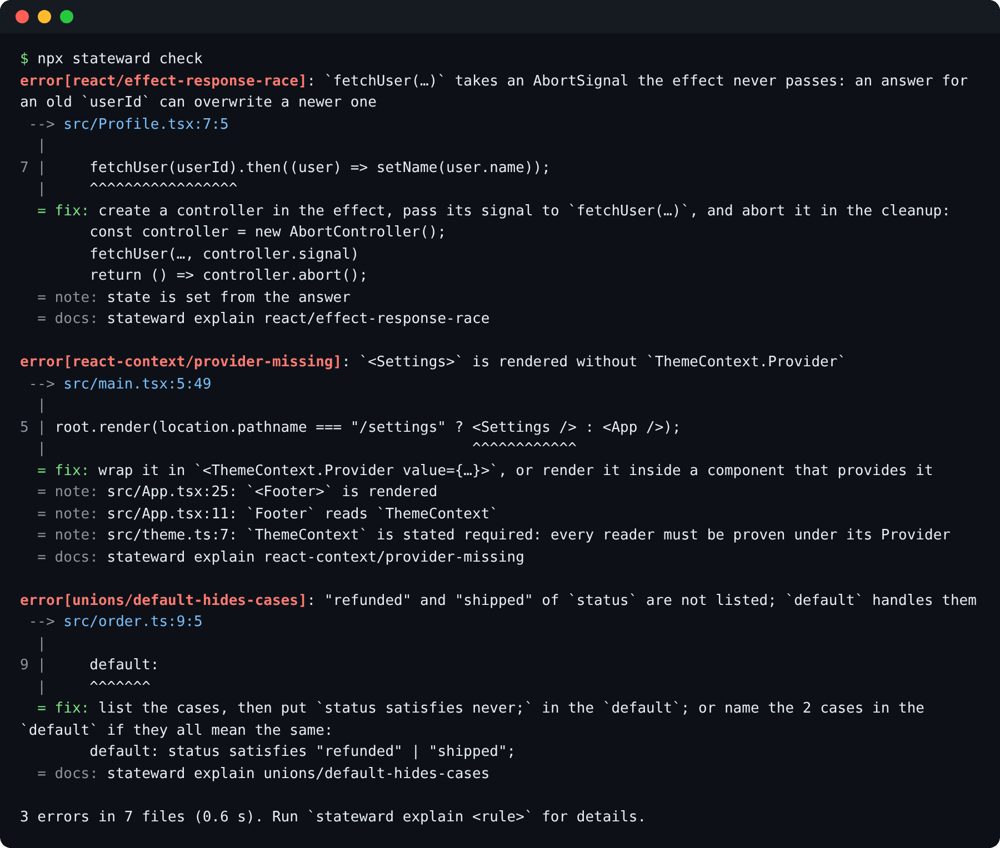

# Quick start

stateward needs Node 20 or newer and the app's packages installed, because it reads imports
through them. Without React's
types the React rules cannot run, and `check` reports their places as "not checked".

## Install and check

In your app's folder:

```bash
npm install --save-dev stateward
```

```bash
npx stateward init --yes
```

`init --yes` picks the packs that fit your `package.json`, writes `stateward.config.ts`, and
prints the command that installs those packs. Run that command.

When the app has more than 20 findings, `init` turns on rollout, which enables the rules one at a
time. Its last line then says:

```text
next: run `npx stateward next` to turn on the first rule
```

With 20 findings or fewer, every rule is already on. Otherwise, turn on the first rule:

```bash
npx stateward next
```

Now check:

```bash
npx stateward check
```

For yarn, pnpm or bun, and the VS Code extension, see [install.md](install.md). Without `--yes`,
`init` asks which packs to use and how strict to be.

## Read a finding

```text
$ npx stateward check
error[unions/default-hides-cases]: "failed", "loading" and "ready" of `status` are not listed; `default` handles them
 --> src/status.ts:7:5
  |
7 |     default:
  |     ^^^^^^^
  = fix: list the cases, then put `status satisfies never;` in the `default`; or name the 3 cases in the `default` if they all mean the same:
        default: status satisfies "failed" | "loading" | "ready";
  = docs: stateward explain unions/default-hides-cases

1 error, 2 warnings in 3 files (1.0 s). Run `stateward explain <rule>` for details.
```

Each finding gives the severity, the rule, the problem, its location and the change to make.
`npx stateward explain <rule>` shows the rule's page, with why it matters, what it flags and how to
fix it. With several packs on, a check of a small React app prints this:



When stateward cannot decide, for example on a type it cannot follow or a package it cannot read,
it reports the place as not checked instead of passing it. The count is on one line above the
summary:

```text
12 places not checked (react/dependency-changes-every-render 12); list them with `--verbose` or `stateward coverage`
```

`stateward coverage` lists them per pack, with the change that would let stateward check them.

`check` exits with 0 when there is no error, 1 when there is at least one, and 2 when it could not
run or a rule failed.

## Next

- Practices for a real app (rollout, which guarantees to state, ignores with a reason, CI on
  changed files, "not checked" places): [best-practices.md](best-practices.md).
- A large app with hundreds of findings, with the rules turned on one at a time and today's
  findings accepted: [work-through-findings.md](work-through-findings.md).
- Every rule, grouped by pack, with what it finds and its severity: [the rules index](../rules/README.md).
- What a function can throw, the hints after its signature and the "handle the known errors"
  action: [errors.md](errors.md).
- Choose packs, rules and severities: [config.md](config.md).
- Check every pull request: [ci.md](ci.md). Check before each commit: [pre-commit.md](pre-commit.md).
- How often stateward is right on real projects: [real-world-results.md](real-world-results.md).

For installation problems, see [install.md](install.md#if-it-goes-wrong). A wrong finding is a bug;
[report it](https://github.com/khoing1111/ts-stateward/issues) as printed, with the smallest code
that causes it.
