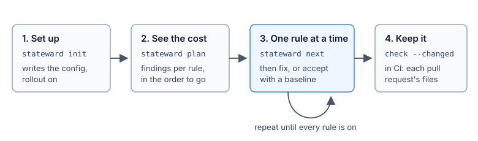

# Work through the findings

A first run on a large app can report more findings than can be fixed at once. To work through
them, turn the rules on one at a time, accept today's findings so that only new ones fail, and apply
the safe fixes in bulk. Commands run in the app's folder, with stateward installed
([install.md](install.md)).



[best-practices.md](best-practices.md) says when to use each step and what to state in the types.

## See where to start

```bash
npx stateward plan
```

`plan` lists every rule by group, with how many places it flags and how many it can fix. The
number on the left is the suggested order. Rules that flag nothing come first, because turning them
on adds no findings.

```text
order  rule                                  findings  fixable  protects

unions/cases
17     unions/non-exhaustive-switch          1        0  Every `switch` over a union handles every case: a `default` handles only the cases it allows, so a case added later is reported where it is not handled.
...
```

## Turn the rules on one at a time

Set `rollout: true` in `stateward.config.ts`. `init` offers this, and sets it when the app has more
than 20 findings. Then run:

```bash
npx stateward next
```

`next` turns on the next rule that flags something, plus every rule that flags nothing. Only the
rules turned on run, in the terminal and in VS Code. They are kept in `stateward.rollout.json`;
commit it.

```text
$ npx stateward next
also on, nothing to fix: records/lookup-misses-key, ...
on: unions/non-exhaustive-switch (1 finding, 0 fixable)
Every `switch` over a union handles every case: a `default` handles only the cases it allows, so a case added later is reported where it is not handled.
```

Run `npx stateward check`, fix the findings, then run `next` again. `next` waits while the last
rule still has findings; `next --anyway` moves on regardless.

To look at one rule or one group (the headings in `plan`) without rollout:

```bash
npx stateward check --rule records/lookup-misses-key
```

```bash
npx stateward check --group unions/cases
```

`--max 5` shows only the five most serious findings.

## Accept what is there today

To accept a rule's current findings so that only new ones fail:

```bash
npx stateward baseline
```

```text
$ npx stateward check
No problems in 3 files (0.0 s) (1 baselined: `stateward baseline --prune` after fixing them).
```

The accepted findings go in `stateward.baseline.json`; commit it. Each is recorded by its rule and
the code on its line, not the line number, so moving code keeps it accepted and changing the line
makes it new. `baseline --prune` drops the fixed ones, and `check --no-baseline` shows them
all again. `next --baseline` turns on the next rule and accepts its findings in one step.

## Fix in bulk

Some fixes cannot change how the code runs, such as renaming an old rule id in an ignore comment. Commit first, then preview and apply them:

```bash
npx stateward check --fix --dry-run
```

```bash
npx stateward check --fix
```

```text
Fixed 7 problems in 4 files; 3 problems need a decision (run without --fix to see them).
```

- Only fixes marked safe are applied. A fix that could change behaviour stays a quick fix in VS
  Code, to review by hand.
- Each fix is verified first: it is applied to a copy of the code, and one that adds a TypeScript
  error on the lines it changes is not applied or offered. The changed files are then checked
  again.
- `--rule`, `--group` and `--changed` limit what is fixed. Baselined and ignored findings are left
  alone.
- The exit code follows what is left, so it works in a script.

## Ignore one case

When the code is correct as written, put a comment above the line with the rule and the reason:

```ts
// stateward-ignore records/lookup-misses-key: keys come from the server's fixed list
const label = labels[status];
```

Use a comment only for code that is intended. A baseline is for findings to fix later.

- Name several rules with commas. `// stateward-ignore-file <rule>: <why>`, above the file's first
  statement, covers the whole file.
- A comment without a reason, one that no longer covers a finding, or one that names an unknown rule
  is reported ([`ignores`](config.md#ignores) sets how strictly).
- `check --no-ignores` shows what the comments cover. `stateward explain stateward/ignore` has the
  details.

## In VS Code

With the extension installed ([install.md](install.md#vs-code)), findings show as squiggles and in
the Problems view as you type, and baselined findings show faintly. The lightbulb offers the fixes,
"Explain", and "Ignore this case here", which writes the comment. The status bar shows where the
rollout is (`Stateward: rule 2 of 9 · 3 left`); click it to turn on the next rule.
[The extension's page](../../packages/vscode/README.md) has the rest.

## Limits

Every check reads ordinary TypeScript. Some checks cover only one common way of writing a pattern.
For example, the Provider check covers contexts created with no default
(`createContext<User | undefined>(undefined)`). Each [rule page](../rules/) says what the rule does
not catch.
